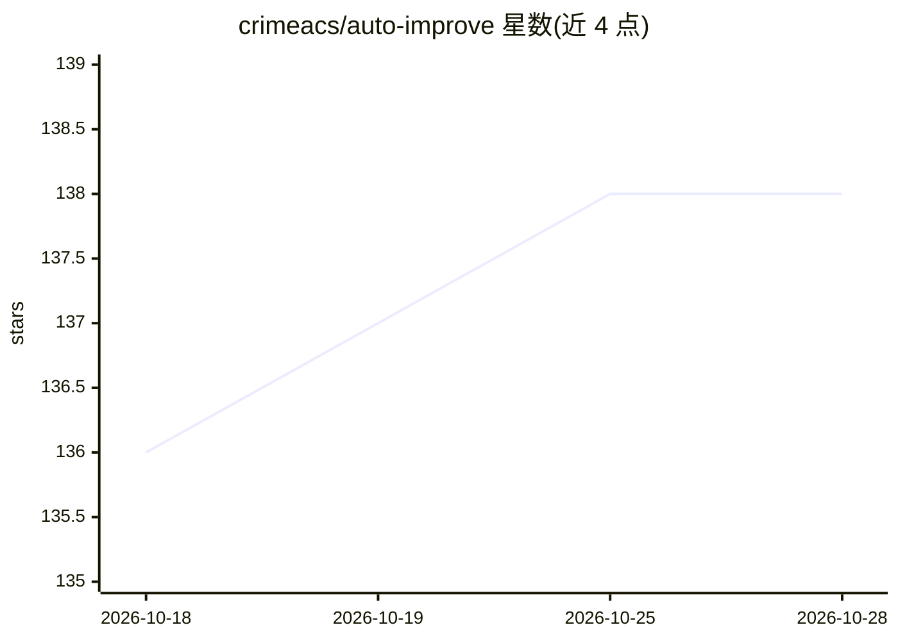

# crimeacs/auto-improve

⭐ 138 · Python · MIT · 推送 2026-08-03 · [GitHub](https://github.com/crimeacs/auto-improve) · 个人维护 · 中文 README

**面向文本工件的 GAN 式自我改进循环：变异-独立评审-只留已验证的提升**

指向任意文本文件（邮件、提示词、README、API 设计等），按评分 rubric 或从工件自动推断的标准，生成 N 个候选变异，由独立的裁判模型评分并做双向消偏的成对判定，仅保留真实胜出的改动，其余回退；每次 keep 生成一次 git commit，git 历史即为改进日志。默认使用 Google Gemini（需 GEMINI_API_KEY，唯一依赖 requests，Python 3.9+），变异模型与评审模型分离。工件须位于 git 仓库内。附带示例工件与 rubric、Rust 实时绘图工具及 ElevenLabs 语音演绎实验功能。适用于开发者改进提示词、文案、API 设计等文本产物。

## 筛选速览

| 维度 | 判定 | 备注 |
|---|---|---|
| AI 角色 | `ai-ecosystem` | LLM/agent 周边工具 |
| 许可风险 | `permissive` | MIT |
| 部署形态 | `library` | 以包/库形式分发 |
| 模型依赖 | — | README 未给出锁定关系 |
| 硬件要求 | — | 无带数字的原话,不猜 |
| 安装摩擦 | `medium` | 含编译或系统依赖之一 |
| 成熟度 | — | 结构信号不足 |

## 能力要点

- 变异模型与评审模型分离（mutate 与 grade 非同一调用）
- 双向消偏成对判定：候选须在两种顺序下胜出冠军才保留，平局丢弃
- Best-of-N 候选与外科手术式 diff（exact→unicode→fuzzy 三级回退），坏补丁不损坏文件
- git 历史即改进日志，每次 commit 为一次已验证的提升

## 适用场景

- 改进提示词、冷邮件、落地页等文本工件并留下可 diff 的改进历史
- 没有现成评分标准时，从工件或 --goal 自动推断 rubric 再迭代
- 对评分 rubric 本身再跑一轮循环，交替改进工件与规范

## 场景标签

`提示工程` `AI 写作` · 领域:Agent 开发

## 证据(README 行号)

> L13: **A GAN-style self-improvement loop for any text artifact.** Point it at a file —
> L35: 1. **A separate judge.** The model that *mutates* never *grades* — grading is a fresh
> L46:   MUTATE   → ask the model for N candidate edits (best-of-N), applied as surgical diffs

## 星数曲线

2026-10-18 136 → 2026-10-28 138（+2）

---
*卡片 v1 · prompt 1.4 · 生成 2026-10-22 · 置信度 mid · 依据 README sha `0a52af0bac43` · [字段定义](../../DATASET.md)*
