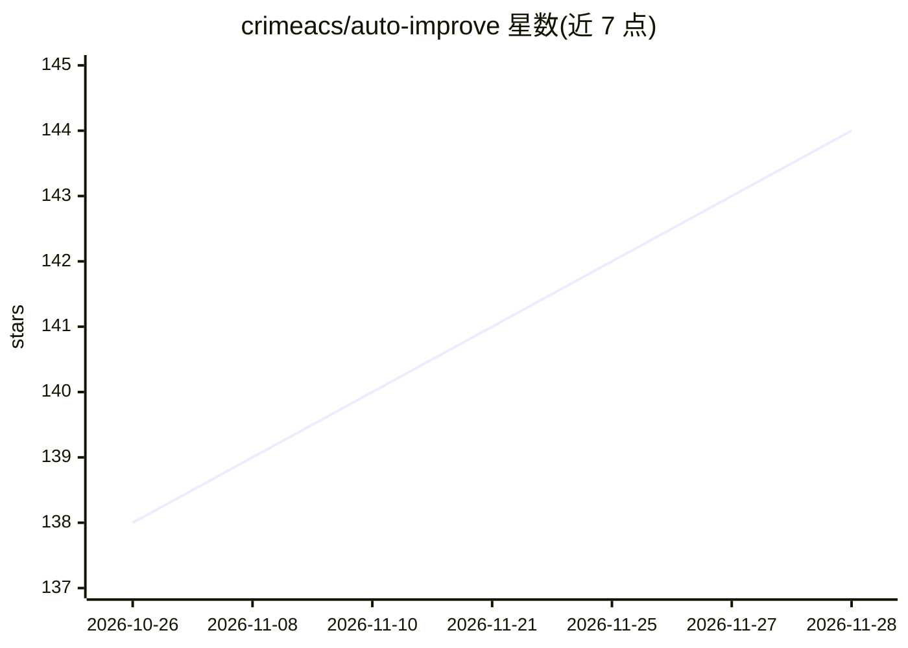

# crimeacs/auto-improve

⭐ 144 · Python · MIT · 推送 2026-11-18 · [GitHub](https://github.com/crimeacs/auto-improve) · 个人维护

**用独立评审模型迭代改写文本产物的自改进循环脚本**

单文件 Python 脚本（依赖 requests），对任意文本产物运行 GAN 式循环：变异器生成 N 个候选补丁，独立评审模型按 rubric 打分，再经双向去位置偏置的成对评审门控，仅保留胜过当前冠军的修改并 git 提交，其余回滚；git 历史即改进日志。可自动从产物推断 rubric，支持生成器（prompt 模板/配置）与 rubric 本身也作为优化对象，附 Self-Improvement Memory（--sim）持续记忆与 Rust macroquad 实时画图工具。需 GEMINI_API_KEY，产物须位于 git 仓库内。

## 筛选速览

| 维度 | 判定 | 备注 |
|---|---|---|
| AI 角色 | `ai-native` | 本体是模型或模型工具 |
| 许可风险 | `permissive` | MIT |
| 部署形态 | `library` | 以包/库形式分发 |
| 模型依赖 | — | README 未给出锁定关系 |
| 硬件要求 | — | 无带数字的原话,不猜 |
| 安装摩擦 | `medium` | 含编译或系统依赖之一 |
| 成熟度 | — | 结构信号不足 |

## 能力要点

- 变异与评审使用相互独立的模型调用，成对评审双序消除位置偏置
- 保留的每次修改以 git 提交记录，可 diff 审查
- 可省略 rubric，用 --goal 由模型自动推断评分标准
- --sim 跨运行/跨产物传递自改进记忆文件

## 适用场景

- 迭代打磨冷邮件、landing page、博客文章等文本产物
- 自动优化 prompt 模板或代码中的 API 设计
- 按自己的评分维度（rubric）控制优化方向

## 场景标签

`提示工程` `AI 写作` · 领域:Agent 开发

## 证据(README 行号)

> L13: **A GAN-style self-improvement loop for any text artifact.** Point it at a file —
> L35: 1. **A separate judge.** The model that *mutates* never *grades* — grading is a fresh
> L72: python3 improve.py --artifact examples/cold-email.txt \

## 星数曲线

2026-10-26 138 → 2026-11-28 144（+6）

---
*卡片 v1 · prompt 1.4 · 生成 2026-11-27 · 置信度 mid · 依据 README sha `69bfc6b1650d` · [字段定义](../../DATASET.md)*
