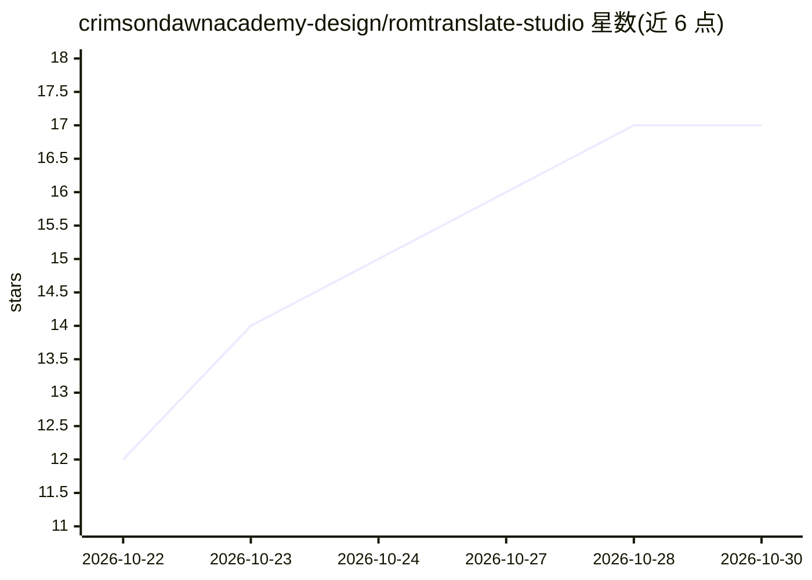

# crimsondawnacademy-design/romtranslate-studio

⭐ 17 · Rust · MIT · 推送 2026-10-26 · [GitHub](https://github.com/crimsondawnacademy-design/romtranslate-studio) · [官网](https://romtranslate-studio.pages.dev) · 个人维护

**本地 AI 翻译复古游戏 ROM 并导出 IPS/BPS 补丁的桌面工具**

面向 ROM 民间翻译者的桌面应用（Tauri 2 / Rust）：自动检测平台、提取文本、调用用户选择的 AI（Ollama 本地、ChatGPT 订阅 via Codex CLI、Claude API 或任意 OpenAI 兼容端点）批量翻译，逐行校验占位符/控制码/字符集/长度，不合规行自动重发 AI，随后回写副本并导出 IPS/BPS 补丁。覆盖 GBA、NDS、NES、SNES、PS1/PS2、PSP 等约 20 个平台，均标注实验性；ROM 不离开本机。自述为 alpha 软件，仅一款商业 GBA 游戏跑通全流程，日文回写仍是瓶颈。

## 筛选速览

| 维度 | 判定 | 备注 |
|---|---|---|
| AI 角色 | `ai-native` | 本体是模型或模型工具 |
| 许可风险 | `permissive` | MIT |
| 部署形态 | `desktop` | 安装包/桌面程序 |
| 模型依赖 | local-ok | 支持本地模型 |
| 硬件要求 | — | 无带数字的原话,不猜 |
| 安装摩擦 | `low` | 无编译、无系统依赖或容器化 |
| 成熟度 | `idea` | |

## 能力要点

- 11 种格式平台检测 + 文本提取、翻译、校验、回写、IPS/BPS 补丁导出全流程
- 逐行校验占位符/控制码/可用字符/长度，不合规格自动重发 AI
- 本地优先：ROM 不上传，支持 Ollama 等本地或 OpenAI 兼容端点
- AI 编码助手辅助生成无法自动读取的游戏文本档案（perfil.toml）

## 适用场景

- 给 GBA/NDS/SFC 等复古游戏做民间翻译并分享补丁
- 用本地 LLM 翻译 ROM 且不让游戏文件离开电脑
- 对工具无法自动解析的游戏用 AI 助手找字表和指针

## 场景标签

 · 领域:游戏本地化/翻译工具

## 证据(README 行号)

> L24: 3. **Translates** with the AI you choose, several batches at a time, telling the model how much room each line has.
> L68: |**Ollama**|free, runs locally|Nothing leaves your computer. Small models struggle to keep lines short.|

## 星数曲线

2026-10-22 12 → 2026-10-30 17（+5）

---
*卡片 v1 · prompt 1.4 · 生成 2026-10-29 · 置信度 mid · 依据 README sha `91a403c29d2a` · [字段定义](../../DATASET.md)*
