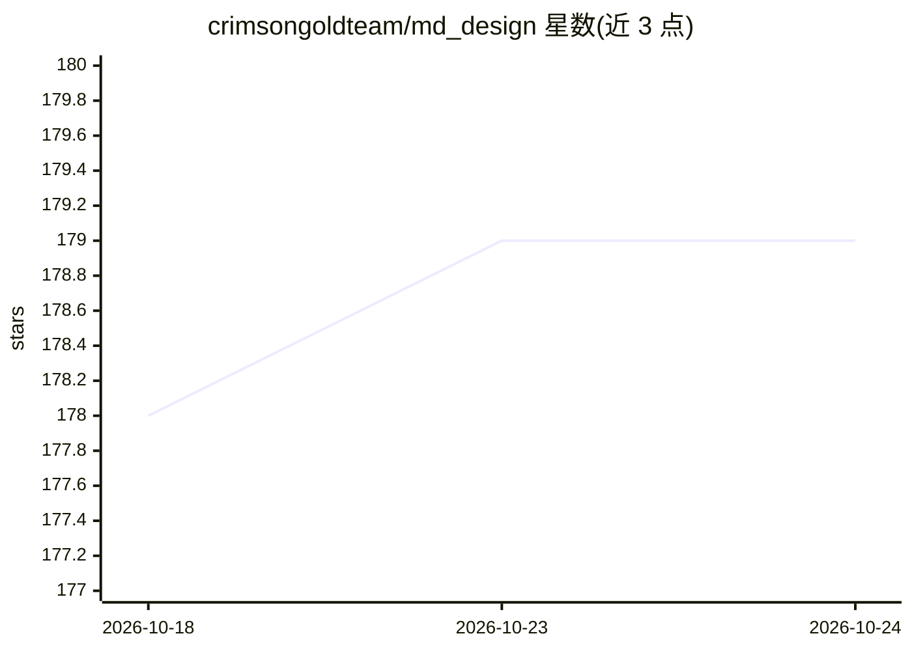

# crimsongoldteam/md_design

⭐ 179 · 1C Enterprise · MIT · 推送 2026-03-11 · [GitHub](https://github.com/crimsongoldteam/md_design) · 组织维护 · 中文 README

**用类 Markdown 语言为 1С:Предприятие 8 快速生成表单原型**

面向 1С:Предприятие 8 平台的表单原型工具：用类 Markdown 的文本语法描述表单，生成可视化界面，并可反向转换；支持可视化拖拽设计、导出原型到配置、自动生成以代码创建属性的程序代码。目标用户为分析师（配合 AI 快速做原型并向客户演示）、开发者（按 1С 标准生成表单与代码）、测试人员（在设计阶段即可编写测试场景）。解析基于 Chevrotain 库，脚本编辑器基于 1С 8.3 代码控制台改造，MIT 许可。

## 筛选速览

| 维度 | 判定 | 备注 |
|---|---|---|
| AI 角色 | `ai-enhanced` | 去掉 AI 部分产品仍成立 |
| 许可风险 | `permissive` | MIT |
| 部署形态 | `None` |  |
| 模型依赖 | — | README 未给出锁定关系 |
| 硬件要求 | — | 无带数字的原话,不猜 |
| 安装摩擦 | `low` | 无编译、无系统依赖或容器化 |
| 成熟度 | — | 结构信号不足 |

## 能力要点

- 类 Markdown 文本语法描述 1С 表单并生成可视化界面，支持双向转换
- 原型可导出到 1С 配置，并自动生成属性创建代码
- 配合 AI 生成原型文本，可在开发前编写测试场景
- 解析基于 Chevrotain，可视化设计与文本语法并存

## 适用场景

- 分析师早期快速做 1С 表单原型并与客户确认界面
- 开发者按 1С 规范从原型生成表单与程序代码
- 测试人员在表单开发前基于原型编写测试场景

## 场景标签

`代码生成` · 领域:编码与开发

## 证据(README 行号)

> L21: Накидка — это инструмент для 1С:Предприятие 8, который позволяет быстро создавать формы по текстовому описанию. Он 
> L40: - Быстрое создание прототипов с помощью силы Искусственного интеллекта

## 星数曲线

2026-10-18 178 → 2026-10-24 179（+1）

---
*卡片 v1 · prompt 1.4 · 生成 2026-10-22 · 置信度 mid · 依据 README sha `0881c0f08181` · [字段定义](../../DATASET.md)*
