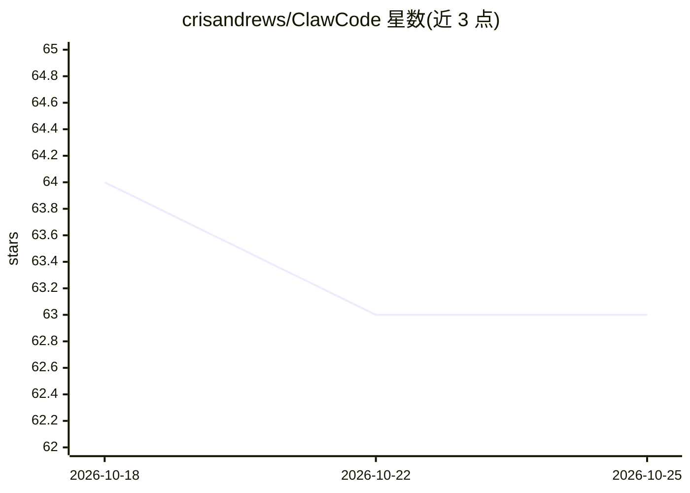

# crisandrews/ClawCode

⭐ 63 · TypeScript · MIT · 推送 2026-10-25 · [GitHub](https://github.com/crisandrews/ClawCode) · [官网](https://github.com/crisandrews/ClawCode#quick-setup) · 个人维护

**给 Claude Code 用户加持久记忆与人格的插件**

ClawCode 是 Claude Code 的插件（非独立运行时），在会话生命周期四个节点注入人格文件与记忆：SessionStart 注入 SOUL.md/IDENTITY.md，PreCompact 压缩前保存事实，Stop 写会话摘要。提供双语（西↔英）记忆检索、夜间三阶段记忆巩固（dreaming）、WhatsApp/Telegram/Discord/iMessage/Slack 多通道消息、TTS/STT 语音、浏览器 WebChat 与 24/7 后台服务，并支持从 OpenClaw 导入人格/记忆/技能。限制：Windows 需在 WSL2 内运行 Claude Code，需 Node.js v18+。

## 筛选速览

| 维度 | 判定 | 备注 |
|---|---|---|
| AI 角色 | `ai-ecosystem` | LLM/agent 周边工具 |
| 许可风险 | `permissive` | MIT |
| 部署形态 | `library` | 以包/库形式分发 |
| 模型依赖 | locked-api |  |
| 硬件要求 | — | 无带数字的原话,不猜 |
| 安装摩擦 | `low` | 无编译、无系统依赖或容器化 |
| 成熟度 | — | 结构信号不足 |

## 能力要点

- 生命周期钩子在 SessionStart/PreCompact/Stop/SessionEnd 四点注入人格与记忆
- 夜间三阶段记忆巩固（Light→REM→Deep，6 项加权信号）
- WhatsApp/Telegram/Discord/iMessage/Slack 多通道消息，斜杠命令跨平台可用
- 执行门控与通道隐私层：非 owner 触发的回合可封锁破坏性工具

## 适用场景

- 让 Claude Code 在多次会话间记住我的名字、偏好与项目上下文
- 通过 WhatsApp 或 Telegram 随时联系同一个带人格的 agent
- 让 agent 全天候后台运行并定期整理长期记忆

## 场景标签

`Agent 记忆` `聊天机器人` · 领域:Agent 开发

## 证据(README 行号)

> L26: ClawCode is a plugin for Claude Code. Install it and Claude Code remembers you between sessions: your name, the age
> L36: ClawCode takes the other route. It extends Claude Code from inside as a plugin, so there's no separate runtime and 
> L62: - Node.js v18+

## 星数曲线

2026-10-18 64 → 2026-10-25 63（-1）

---
*卡片 v1 · prompt 1.4 · 生成 2026-10-24 · 置信度 mid · 依据 README sha `e25ecfe06cea` · [字段定义](../../DATASET.md)*
