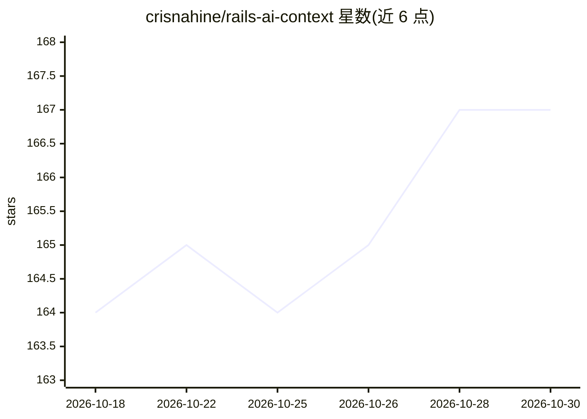

# crisnahine/rails-ai-context

⭐ 167 · Ruby · MIT · 推送 2026-10-29 · [GitHub](https://github.com/crisnahine/rails-ai-context) · [官网](https://crisnahine.github.io/rails-ai-context) · 个人维护

**给 Rails 开发者：35 个只读 MCP/CLI 工具让 AI 编码助手读取真实应用结构**

面向 Rails 应用开发者的 Ruby gem：提供 35 个只读工具，通过 MCP（stdio 或挂载 HTTP）或命令行，让 Claude Code、Cursor、GitHub Copilot、OpenCode、Codex CLI 等 AI 编码助手按需查询应用的 schema、模型、路由、控制器、视图、任务与约定，替代凭训练数据猜测。模型经 Prism AST 解析并标注 [VERIFIED]/[INFERRED]；应用无法启动时可从静态文件应答；SQL 只读带超时、行数限制与列脱敏；为各 AI 工具生成含六条反幻觉规则的上下文文件。要求 Ruby 3.1+ 与 Rails 7.0+。

## 筛选速览

| 维度 | 判定 | 备注 |
|---|---|---|
| AI 角色 | `ai-ecosystem` | LLM/agent 周边工具 |
| 许可风险 | `permissive` | MIT |
| 部署形态 | `None` |  |
| 模型依赖 | — | README 未给出锁定关系 |
| 硬件要求 | — | 无带数字的原话,不猜 |
| 安装摩擦 | `low` | 无编译、无系统依赖或容器化 |
| 成熟度 | — | 结构信号不足 |

## 能力要点

- 35 个只读工具覆盖 schema、模型、路由、控制器、视图、测试、安全等
- MCP over stdio / 应用内挂载 HTTP / 纯 CLI 三种接入方式
- [VERIFIED]/[INFERRED] 置信标注，应用无法启动时走静态解析
- 为五款 AI 工具生成含六条反幻觉规则的上下文文件

## 适用场景

- 让 AI 编码助手在改代码前核对我的 Rails schema 与关联
- 团队统一为多个 AI 编码工具配置项目 MCP 服务
- 查询只本人应用知道的信息（如 users 表有哪些列）

## 场景标签

 · 领域:开发工具/AI 编码集成

## 证据(README 行号)

> L24: **rails-ai-context** makes your Rails app the source of truth for your AI coding assistant. The assistant stops gue
> L113: |**35 read-only tools**|Schema, models, controllers, routes, views, Stimulus, Turbo, jobs, services, mailers, i18n
> L116: |**Context files per AI tool**|`CLAUDE.md`, Cursor rules, Copilot instructions, `AGENTS.md`, each with the MCP con

## 星数曲线

2026-10-18 164 → 2026-10-30 167（+3）

---
*卡片 v1 · prompt 1.4 · 生成 2026-10-22 · 置信度 high · 依据 README sha `2efbd3a2ec98` · [字段定义](../../DATASET.md)*
