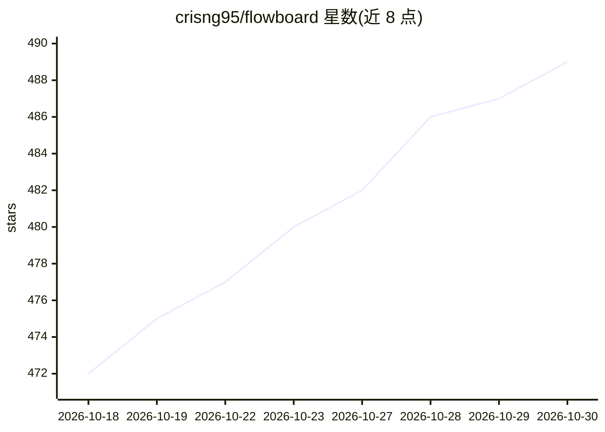

# crisng95/flowboard

⭐ 489 · Python · 推送 2026-10-02 · [GitHub](https://github.com/crisng95/flowboard) · 个人维护

**本地无限画布：节点化编排 AI 产品视频生成工作流**

单用户本地运行的无穷画布工作台，面向电商短视频创意：把角色、产品、场景图与视频作为节点组成有向图，通过 Chrome MV3 扩展在已登录的 flow.google.com 页面内代理请求，调用 Google Flow 的 Veo 3.1 i2v 与图像生成；自动提示词由可切换的 LLM CLI（Claude Code 默认，另有 Gemini/Codex）合成。硬性限制：需 Flow Pro/Ultra 付费方案、必须加载扩展并保持 Flow 标签页打开、本地存储为 SQLite + 媒体缓存目录。

## 筛选速览

| 维度 | 判定 | 备注 |
|---|---|---|
| AI 角色 | `ai-native` | 本体是模型或模型工具 |
| 许可风险 | `permissive` | — |
| 部署形态 | `library` | 以包/库形式分发 |
| 模型依赖 | locked-api |  |
| 硬件要求 | — | 无带数字的原话,不猜 |
| 安装摩擦 | `medium` | 含编译或系统依赖之一 |
| 成熟度 | — | 结构信号不足 |

## 能力要点

- 角色/产品/场景/视频全部节点化，边为真实数据依赖，变体可独立重生成
- Chrome 扩展在 Flow 页面内签名代理 batchexecute RPC，代理无直连路径
- 自动提示词合成：Vision 描述各参考图后拼入时尚编辑风格提示词，按场景切换动作词汇
- 4 变体图像可单次派发 4 个 i2v 视频生成

## 适用场景

- 电商短视频创意：同一角色与产品批量生成多场景视频
- 在画布上以图结构管理整条campaign的素材与变体
- 自动生成提示词并保持角色形象一致性

## 场景标签

`视频生成` `图像生成` `提示工程` · 领域:Agent 开发

## 证据(README 行号)

> L31:  A local-only, single-user infinite-canvas workspace for AI media workflows.
> L32:  Compose characters, products, scenes, and videos as a directed graph. Drive generation through a Chrome extension 

## 星数曲线

2026-10-18 472 → 2026-10-30 489（+17）

---
*卡片 v1 · prompt 1.4 · 生成 2026-10-21 · 置信度 mid · 依据 README sha `f8a0c28dc049` · [字段定义](../../DATASET.md)*
