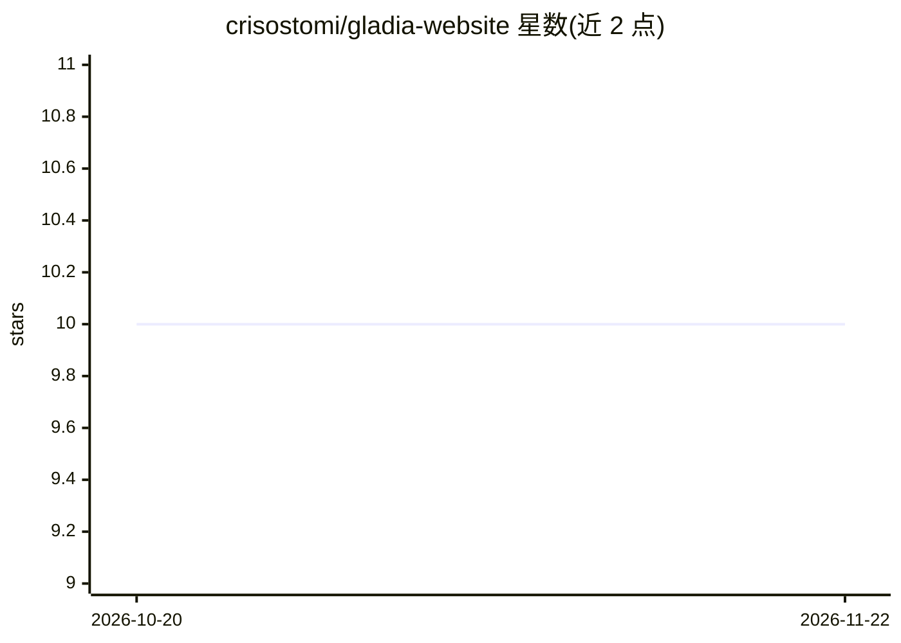

# crisostomi/gladia-website

⭐ 10 · TeX · MIT · 推送 2026-10-02 · [GitHub](https://github.com/crisostomi/gladia-website) · [官网](https://gladia.di.uniroma1.it/) · 组织维护

**罗马 Sapienza 大学 GLADIA 研究组官网**

该仓库是罗马 Sapienza 大学 GLADIA 研究组（由 Prof. E. Rodolà 领导）的网站源码，主题标签涉及 deep-learning 与 research-group。README 仅一行标题，未提供安装、运行、部署方式或功能说明。从仓库性质推断，其内容用于展示研究组成员、成果与动态等信息，供访问者了解该研究组。

## 筛选速览

| 维度 | 判定 | 备注 |
|---|---|---|
| AI 角色 | `ai-knowledge` | 知识聚合/清单类 |
| 许可风险 | `permissive` | MIT |
| 部署形态 | `None` |  |
| 模型依赖 | — | README 未给出锁定关系 |
| 硬件要求 | — | 无带数字的原话,不猜 |
| 安装摩擦 | `low` | 无编译、无系统依赖或容器化 |
| 成熟度 | — | 结构信号不足 |

## 能力要点

- Sapienza 大学 GLADIA 研究组官网站点
- 主题标签含 deep-learning 与 research-group
- 由 Prof. E. Rodolà 领导的研究组维护

## 适用场景

- 了解 GLADIA 研究组的成员与研究方向
- 查找该研究组发表的相关工作信息

## 场景标签

 · 领域:学术/研究组网站

## 证据(README 行号)

> L1: # GLADIA Lab Website

## 星数曲线

2026-10-20 10 → 2026-11-22 10（+0）

---
*卡片 v1 · prompt 1.4 · 生成 2026-11-19 · 置信度 low · 依据 README sha `e21e1737d49a` · [字段定义](../../DATASET.md)*
