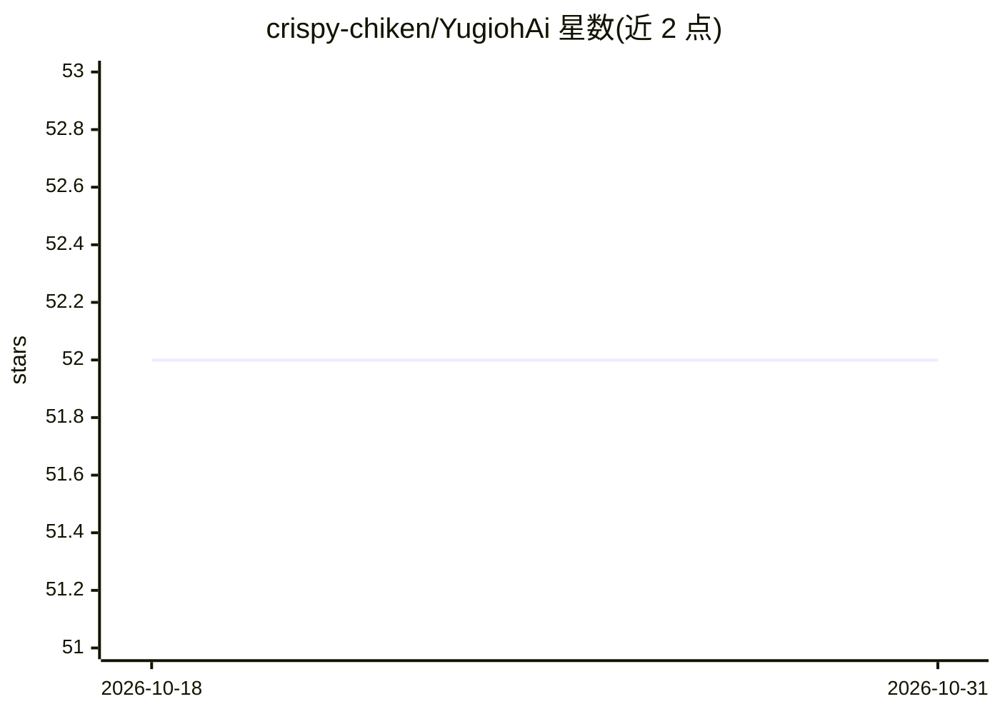

# crispy-chiken/YugiohAi

⭐ 52 · HTML · GPL-3.0 · 推送 2026-05-27 · [GitHub](https://github.com/crispy-chiken/YugiohAi) · 个人维护

**游戏王对战与组卡 AI 机器人（Python+C#，WIP）**

面向游戏王（YGOPro/EDOPro）的 AI 学习项目，包含两个 AI：Python 编写的组卡 AI 与 C#（基于 WindBot）编写的对战 AI。对战部分通过修改 EDOPro 源码启动 LAN 模式自动对局，训练数据存入 SQLite 数据库，Python 脚本（train_ai.py/read_game_data.py/get_action_weights.py）负责训练权重并运行 HTTP 服务供 WindBot 调用；支持 MCTS 回滚数、手动训练、胜率阈值停止等参数。README 多处标注功能仍在开发中（final build、In progress），需自行构建 EDOPro 与 WindBot 并修改其代码。

## 筛选速览

| 维度 | 判定 | 备注 |
|---|---|---|
| AI 角色 | `ai-native` | 本体是模型或模型工具 |
| 许可风险 | `viral` | GPL-3.0 |
| 部署形态 | `desktop` | 安装包/桌面程序 |
| 模型依赖 | — | README 未给出锁定关系 |
| 硬件要求 | — | 无带数字的原话,不猜 |
| 安装摩擦 | `low` | 无编译、无系统依赖或容器化 |
| 成熟度 | `idea` | |

## 能力要点

- 对战 AI（WindBot/C#）与组卡 AI（Python）双部分架构
- 训练数据存入 SQLite（.cdb）数据库并可重置
- get_action_weights.py 运行 HTTP 服务供 WindBot 实时调用权重
- 支持 MCTS、手动对局训练、胜率阈值自动停止等参数

## 适用场景

- 我想让 AI 自动打大量游戏王对局并记录训练数据
- 我想研究游戏王对战 AI 的权重学习与决策过程
- 我想用指定卡组（.ydk）让 AI 代打或陪练

## 场景标签

`强化学习` · 领域:训练与推理

## 证据(README 行号)

> L2: This is a Yugioh Ai Simulator.
> L13: There are 2 Ais that need to made. A deck building Ai which is written in python. And a game Ai written in c#.

## 星数曲线

2026-10-18 52 → 2026-10-31 52（+0）

---
*卡片 v1 · prompt 1.4 · 生成 2026-10-24 · 置信度 mid · 依据 README sha `4ae128b6093c` · [字段定义](../../DATASET.md)*
