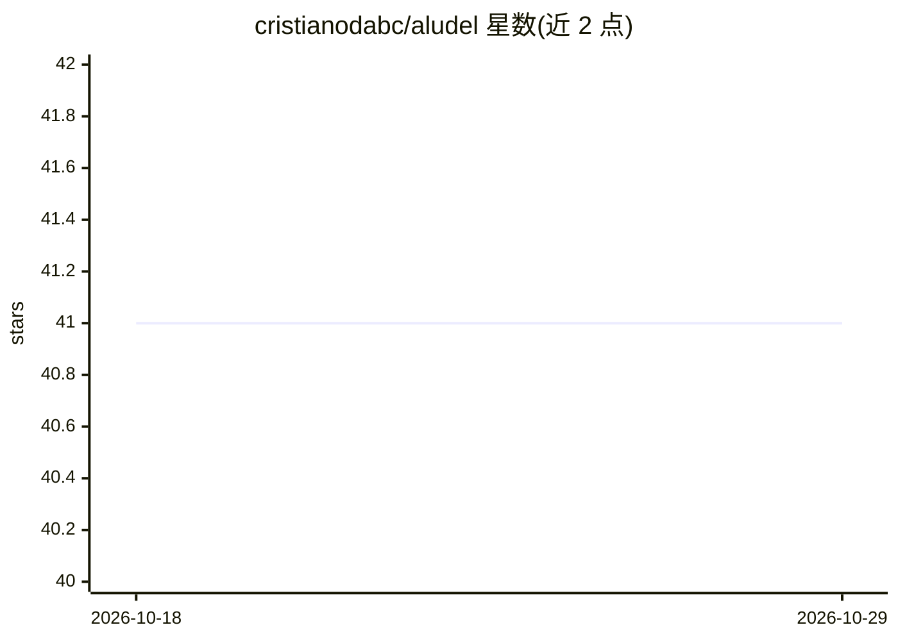

# cristianodabc/aludel

⭐ 41 · Elixir · Apache-2.0 · 推送 2026-10-26 · [GitHub](https://github.com/cristianodabc/aludel) · [官网](https://hexdocs.pm/aludel) · 个人维护

**Elixir/Phoenix 的 LLM 评测与提示词测试工作台**

面向 Elixir 应用的 Phoenix 原生 LLM 评测工具，可嵌入现有 Phoenix 应用或独立运行。提供跨 OpenAI、Anthropic、Gemini、Ollama、xAI、Groq、OpenRouter 的模型对比，支持提示词版本管理、确定性断言与模型裁判的评测套件、红队数据集、质量门禁与 LLM 可观测性，通过 Dashboard UI、Mix CLI 与 Elixir API 三种接口访问同一份持久化数据；可输出 JUnit XML 与 GitHub annotation 报告接入 CI。

## 筛选速览

| 维度 | 判定 | 备注 |
|---|---|---|
| AI 角色 | `ai-ecosystem` | LLM/agent 周边工具 |
| 许可风险 | `permissive` | Apache-2.0 |
| 部署形态 | `self-host` | docker 或自建部署 |
| 模型依赖 | local-ok | 支持本地模型 |
| 硬件要求 | — | 无带数字的原话,不猜 |
| 安装摩擦 | `low` | 无编译、无系统依赖或容器化 |
| 成熟度 | — | 结构信号不足 |

## 能力要点

- 同一提示词跨 7 家 provider 对比输出、延迟、token 用量与成本
- 确定性断言、rubric 裁判、重复采样（最多 20 次）与版本化红队案例目录
- mix aludel.eval 以 JSON/YAML manifest 无头执行套件并输出 JUnit XML/GitHub annotation
- 可嵌入 Phoenix 路由或以独立应用/Docker Compose 部署

## 适用场景

- 在 Elixir 项目中直接用 ExUnit 断言 LLM 输出并做 CI 门禁
- 对比同一提示词在不同模型厂商下的质量、成本与延迟
- 把提示注入、信息泄露等红队案例沉淀为可回归的安全评测套件
- 追踪提示词版本演进的质量/成本/延迟权衡（Pareto 分析）

## 场景标签

`模型评测` `提示工程` `LLM 可观测性` · 领域:Agent 开发

## 证据(README 行号)

> L8: Aludel is a Phoenix-native LLM evaluation workbench for Elixir applications. It combines prompt testing, model compa
> L14: - Assert generated output directly in ExUnit, or execute and gate persisted suites from application tests and CI.

## 星数曲线

2026-10-18 41 → 2026-10-29 41（+0）

---
*卡片 v1 · prompt 1.4 · 生成 2026-10-25 · 置信度 high · 依据 README sha `d00204518870` · [字段定义](../../DATASET.md)*
