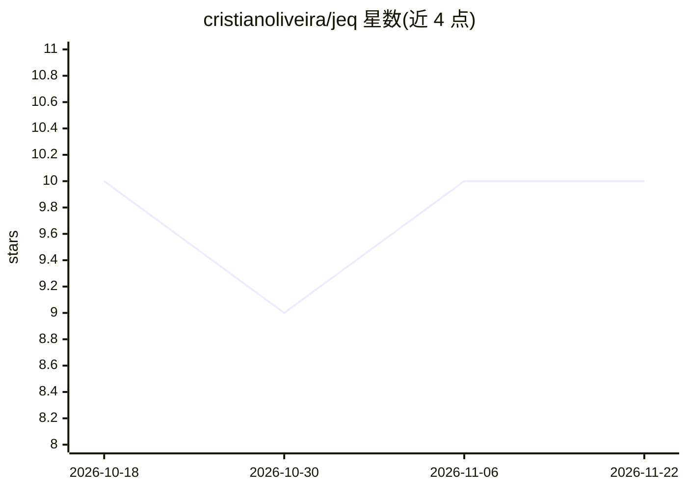

# cristianoliveira/jeq

⭐ 10 · Go · MIT · 推送 2026-09-27 · [GitHub](https://github.com/cristianoliveira/jeq) · 个人维护

**让脚本和 Agent 在终端以管道方式调用模型的 CLI**

jeq 是一个可管道组合的命令行工具，让脚本与 Agent 在终端中向 Jev 提出类型化问题，无需样板代码。提供 ask/map/rate/reduce/rank/models 等子命令（经 TypeSafe API 调用），validate 与 gate 在本地运行；gate 以退出码 0/10/11 表达通过/拒绝/不确定，便于 Bash 管道处理。自带 --help 与 examples 自说明，Agent 无需安装专属技能即可使用；调用需设置 TYPESAFE_API_KEY，工具本身不执行动作、不跨命令保留状态。

## 筛选速览

| 维度 | 判定 | 备注 |
|---|---|---|
| AI 角色 | `ai-ecosystem` | LLM/agent 周边工具 |
| 许可风险 | `permissive` | MIT |
| 部署形态 | `None` |  |
| 模型依赖 | — | README 未给出锁定关系 |
| 硬件要求 | — | 无带数字的原话,不猜 |
| 安装摩擦 | `low` | 无编译、无系统依赖或容器化 |
| 成熟度 | — | 结构信号不足 |

## 能力要点

- ask/map/rate/reduce/rank 等管道式模型调用子命令，validate/gate 本地运行
- gate 用退出码 0/10/11 表达决策结果，适配 Bash 管道与 pipefail
- CLI 自解释：--help 列出命令与示例，Agent 无需专属技能即可使用
- 提供 Linux 安装脚本、macOS 校验和流程与 Nix 安装方式

## 适用场景

- 在 Shell 脚本里对集合数据做模型评级、排序或归约
- 让 AI Agent 直接通过命令行调用模型处理任务
- 用 gate 在流水线中做带阈值的决策把关

## 场景标签

 · 领域:开发工具/LLM 集成

## 证据(README 行号)

> L7: `jeq` lets scripts and agents ask Jev typed questions within the terminal, no boilerplate.
> L61: - `ask`, `map`, `rate`, `reduce`, `rank`, and `models` call TypeSafe. `validate`

## 星数曲线

2026-10-18 10 → 2026-11-22 10（+0）

---
*卡片 v1 · prompt 1.4 · 生成 2026-11-22 · 置信度 mid · 依据 README sha `4c8a4c85ad0a` · [字段定义](../../DATASET.md)*
