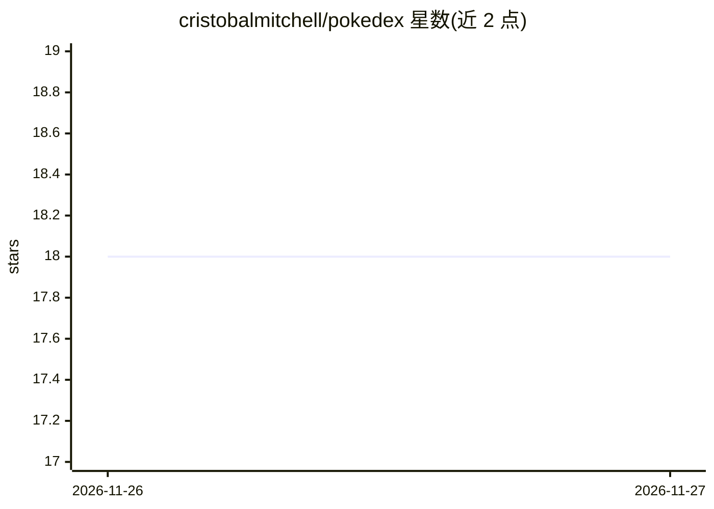

# cristobalmitchell/pokedex

⭐ 18 · Jupyter Notebook · NOASSERTION · 推送 2026-11-25 · [GitHub](https://github.com/cristobalmitchell/pokedex) · [官网](https://www.kaggle.com/cristobalmitchell/pokedex) · 个人维护

**覆盖全部 1,025 只宝可梦的结构化数据集与可复现构建管线**

收录 Gen I–IX 全部 1,025 种宝可梦及 1,578 个形态的表格数据：种族值、招式与学习表、进化条件、特性、11 种语言图鉴文本、野外遭遇，以及 2014 年至今逐月的 Smogon 使用率与现行分级。附带 7 张风格共 7,696 张图片、2,024 个叫声音频，含按物种划分并按属性分层的训练/验证/测试切分。数据以 CSV 与单个 SQLite 库提供，全部表格可由 scripts/ 下管线从 Serebii、PokéAPI、Showdown、Smogon 等来源重建，并配 validate.py 做键、数值与跨表一致性校验。

## 筛选速览

| 维度 | 判定 | 备注 |
|---|---|---|
| AI 角色 | `ai-knowledge` | 知识聚合/清单类 |
| 许可风险 | `none` | NOASSERTION |
| 部署形态 | `None` |  |
| 模型依赖 | — | README 未给出锁定关系 |
| 硬件要求 | — | 无带数字的原话,不猜 |
| 安装摩擦 | `low` | 无编译、无系统依赖或容器化 |
| 成熟度 | — | 结构信号不足 |

## 能力要点

- 1,025 物种/1,578 形态全量结构化表格，含 66.6 万条学习表记录与 52 万条 Smogon 月度使用率
- 11 种语言图鉴文本，含简繁中文
- 7,696 张图片与 2,024 个叫声均带形态标签与固定数据集切分
- scripts/ 下管线可完整复现，validate.py 做完整性与一致性检查

## 适用场景

- 做宝可梦图片/叫声的分类模型训练（自带 train/val/test 切分）
- 分析 Smogon 对战环境的使用率与分级变化趋势
- 为游戏工具或图鉴应用提供本地结构化数据源

## 场景标签

`图像视频处理` `模型训练` `数据分析` · 领域:效率与自动化

## 证据(README 行号)

> L1: # The Complete Pokédex Dataset
> L9: Species data is scraped from Serebii's Pokédex, with official descriptions from pokemon.com and artwork from Bulbape
> L139: ## Licenses

## 星数曲线

2026-11-26 18 → 2026-11-27 18（+0）

---
*卡片 v1 · prompt 1.4 · 生成 2026-11-26 · 置信度 high · 依据 README sha `b98333b91bca` · [字段定义](../../DATASET.md)*
