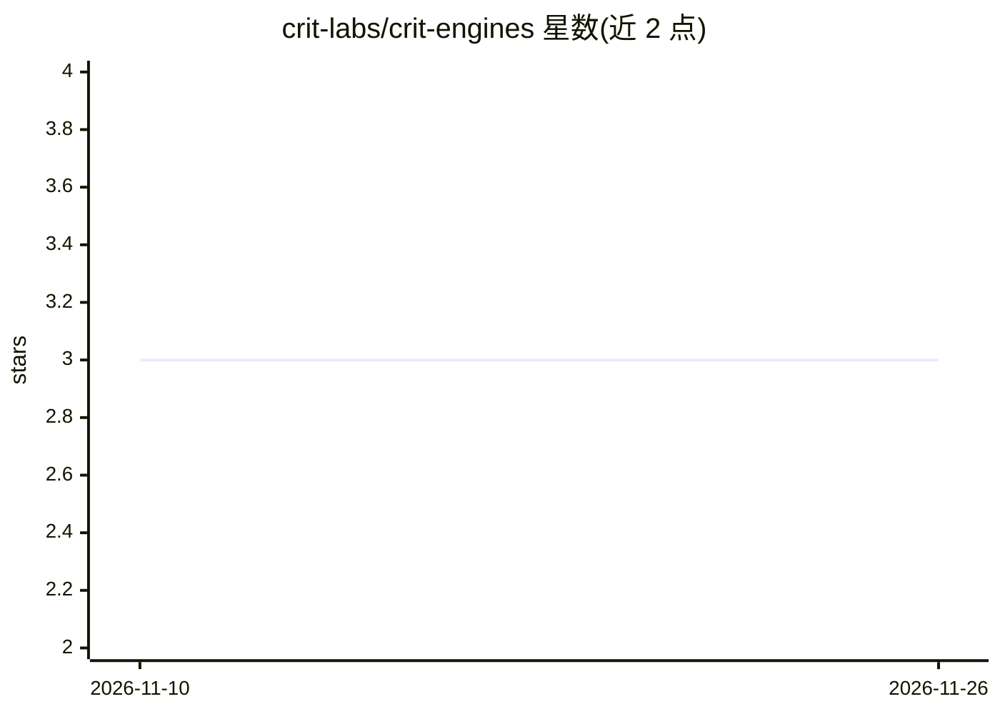

# crit-labs/crit-engines

⭐ 3 · Python · Apache-2.0 · 推送 2026-11-24 · [GitHub](https://github.com/crit-labs/crit-engines) · [官网](https://crit-hub.dev) · 组织维护

**crit-hub 收录的 LLM 推理引擎源码仓库**

存放用 crit 构建的推理引擎的源码，各引擎在 crit-hub 的 engines/ 目录下提供说明（模型、设计、实测结果、检查与限制）及 card.yaml，其中固定指向本仓库对应 commit，需从该 commit 构建引擎。仓库按引擎名分目录，含 engine 源码与配置、THIRD_PARTY.md 依赖致谢、LICENSES.txt 许可文本；模型权重、构建产物、二进制与日志不入库，.gitignore 用白名单控制发布文件。旧适配器引擎已移除并以插件包形式回归。

## 筛选速览

| 维度 | 判定 | 备注 |
|---|---|---|
| AI 角色 | `ai-ecosystem` | LLM/agent 周边工具 |
| 许可风险 | `permissive` | Apache-2.0 |
| 部署形态 | `None` |  |
| 模型依赖 | — | README 未给出锁定关系 |
| 硬件要求 | — | 无带数字的原话,不猜 |
| 安装摩擦 | `low` | 无编译、无系统依赖或容器化 |
| 成熟度 | — | 结构信号不足 |

## 能力要点

- 每个引擎通过 card.yaml 固定本仓库 commit 源码
- crit-hub 提供各引擎的模型、实测结果、构建与开聊说明
- 仓库仅存源码与许可文件，权重与二进制不入库
- 旧适配器引擎以插件包形式重建后迁回

## 适用场景

- 查看某个 crit 推理引擎的源码与依赖许可
- 按 card.yaml 固定的 commit 构建对应引擎
- 向 crit 生态提交或追溯引擎来源

## 场景标签

`推理引擎` · 领域:训练与推理

## 证据(README 行号)

> L3: The source of the inference engines built with crit and
> L10: crit-hub is where to read about them: every engine's README there states its model, design,

## 星数曲线

2026-11-10 3 → 2026-11-26 3（+0）

---
*卡片 v1 · prompt 1.4 · 生成 2026-11-22 · 置信度 mid · 依据 README sha `c9f0e03077ef` · [字段定义](../../DATASET.md)*
