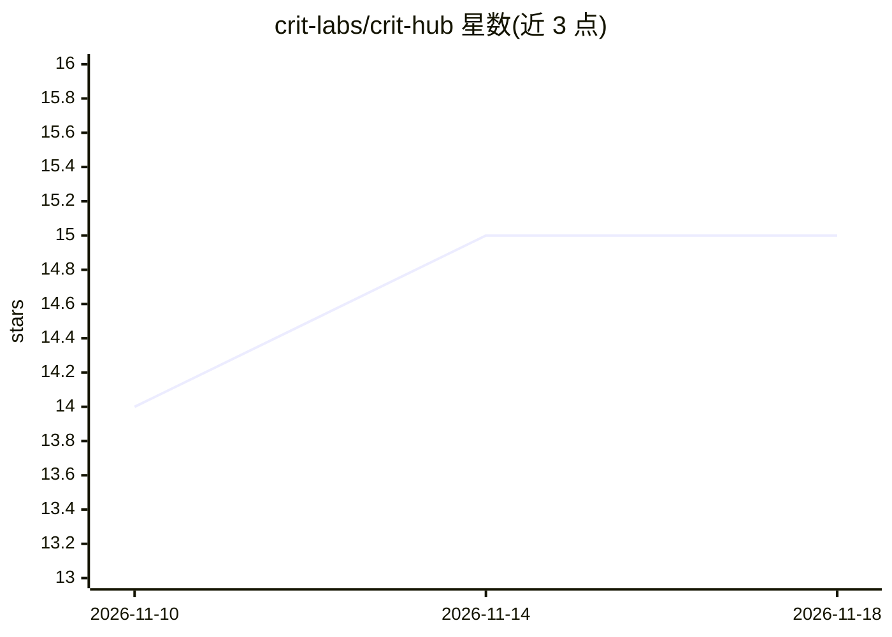

# crit-labs/crit-hub

⭐ 15 · Python · Apache-2.0 · 推送 2026-11-12 · [GitHub](https://github.com/crit-labs/crit-hub) · [官网](https://crit-hub.dev) · 组织维护

**按 GPU 与模型组织的定制推理引擎注册表，供查找现成引擎**

crit-labs 维护的推理引擎注册表：按目标 GPU 和模型组织条目，每个引擎位于 engines/<owner>/<engine>/，由 card.yaml 生成 README，固定源码 commit、Hugging Face checkpoint（SHA-256）并统一给出六个统计指标（decode、prefill、TTFT、困惑度、KL 散度、上下文）。自带证据、已知限制与贡献者仓库链接；crit 构建的引擎密封源码存放于 crit-engines，外部引擎标记为未审第三方代码。定位是注册表而非排行榜，同一 GPU 和模型可并存多个设计。用户可直接浏览或让 coding agent 按提示词检索并构建运行引擎。

## 筛选速览

| 维度 | 判定 | 备注 |
|---|---|---|
| AI 角色 | `ai-knowledge` | 知识聚合/清单类 |
| 许可风险 | `permissive` | Apache-2.0 |
| 部署形态 | `None` |  |
| 模型依赖 | — | README 未给出锁定关系 |
| 硬件要求 | — | 无带数字的原话,不猜 |
| 安装摩擦 | `low` | 无编译、无系统依赖或容器化 |
| 成熟度 | — | 结构信号不足 |

## 能力要点

- 条目按 GPU 与模型组织，card.yaml 供 agent 读取
- 统一六项统计指标并固定源码 commit 与 checkpoint SHA-256
- 区分 crit 密封源码引擎与未审第三方引擎
- 定位为注册表而非排行榜，多设计可并存

## 适用场景

- 在搭建前查找适配我这块 GPU 和目标模型的现成推理引擎
- 基于一个可运行的引擎改-port 到其他 GPU 或相关模型
- 为 coding agent 提供可机器读取的引擎元数据进行检索构建

## 场景标签

 · 领域:LLM 基础设施/推理引擎注册表

## 证据(README 行号)

> L14: **`crit-hub` is a registry of bespoke inference engines, organized by GPU and model,
> L18: > there is no Hugging Face for inference engines. crit-hub collects them in one place: each

## 星数曲线

2026-11-10 14 → 2026-11-18 15（+1）

---
*卡片 v1 · prompt 1.4 · 生成 2026-11-18 · 置信度 high · 依据 README sha `e390530abede` · [字段定义](../../DATASET.md)*
