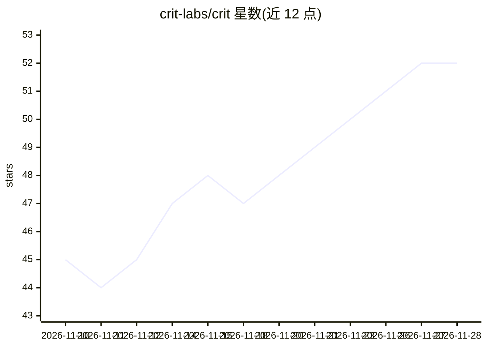

# crit-labs/crit

⭐ 52 · Python · Apache-2.0 · 推送 2026-11-27 · [GitHub](https://github.com/crit-labs/crit) · [官网](https://crit-hub.dev) · 组织维护

**给编码 agent 用的推理引擎构建与优化工具包**

面向被编码 agent（如 Claude Code、Codex）驱动的工具包：提供引擎运行时基础（Core，含请求调度、KV cache、CUDA backend 等）、以插件形式组织的推理加速策略（Inference）、在本机针对用户 GPU 调优的自有 GPU kernel（Kernels），以及基于硬件物理上限的评测工具 crit-eval。agent 以候选引擎迭代方式构建，每步记录、消融、测量；crit serve 以 OpenAI 兼容等 API 提供服务。限制：kernel 需本机构建调优，无预编译下载。

## 筛选速览

| 维度 | 判定 | 备注 |
|---|---|---|
| AI 角色 | `ai-ecosystem` | LLM/agent 周边工具 |
| 许可风险 | `permissive` | Apache-2.0 |
| 部署形态 | `None` |  |
| 模型依赖 | local-ok | 支持本地模型 |
| 硬件要求 | — | 无带数字的原话,不猜 |
| 安装摩擦 | `medium` | 含编译或系统依赖之一 |
| 成熟度 | — | 结构信号不足 |

## 能力要点

- Core 运行时：调度、KV cache、CUDA graph、结构化输出等基础组件
- 推理策略以插件形式提供，附消融测量各插件贡献
- 自有 GPU kernel 在本机针对目标 GPU 与模型 sweep 调优并以 FP64 校验
- crit-eval 基于硬件带宽/矩阵乘上限做物理评测，质量为一等 KPI

## 适用场景

- 让我的编码 agent 为特定 GPU 和模型构建优化推理引擎
- 对比多个自建推理引擎候选的速度与质量
- 测量引擎距硬件物理上限还有多少性能空间

## 场景标签

`推理引擎` `模型评测` · 领域:评测与运维

## 证据(README 行号)

> L17: **Your coding agent builds the engine; `crit` gives it the runtime, the techniques, the kernels and the measurement
> L30: Give one of these prompts to your coding agent and specify your target LLM or target engine:
> L195: `crit-eval` is a speed and quality measurement tool to compare inference engines honestly.

## 星数曲线

2026-11-10 45 → 2026-11-28 52（+7）

---
*卡片 v1 · prompt 1.4 · 生成 2026-11-18 · 置信度 high · 依据 README sha `91c379153d55` · [字段定义](../../DATASET.md)*
