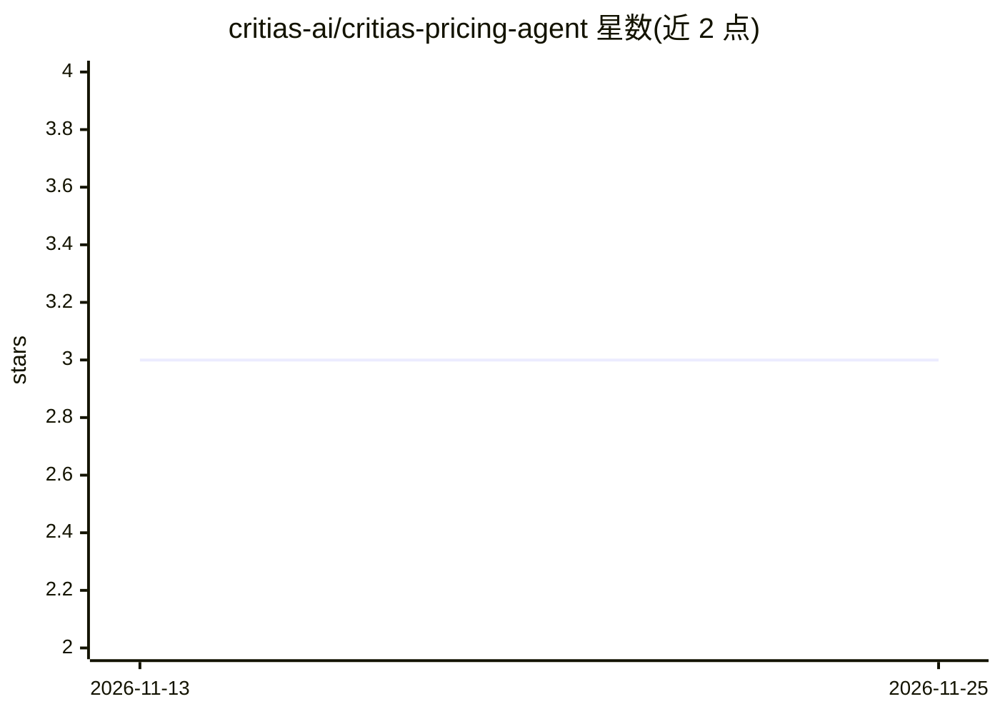

# critias-ai/critias-pricing-agent

⭐ 3 · TypeScript · Apache-2.0 · 推送 2026-11-23 · [GitHub](https://github.com/critias-ai/critias-pricing-agent) · [官网](https://critias.ai) · 组织维护

**本地定价分析 agent：对自己数据做毛利与价量分析并核验数字**

Critias 是一个开源定价分析 agent，以本地浏览器应用形式运行：对 CSV、Excel、文本和 Markdown 文件用 SQL 与 Python 脚本做毛利、价量混和价格实现分析，每个实质性数字必须出现在实际执行的查询或脚本输出中，表格与图表从冻结的结果文件构建而非模型文本。基于 Pi agent 框架（提供模型层、agent 循环与工具调用），捆绑 7 个定价技能与数据检查器；计算本地执行，模型请求发往用户自行配置的 provider。状态为 experimental research preview，真实业务数据验证尚未完成，不支持电子表格公式重算与多用户托管。

## 筛选速览

| 维度 | 判定 | 备注 |
|---|---|---|
| AI 角色 | `ai-native` | 本体是模型或模型工具 |
| 许可风险 | `permissive` | Apache-2.0 |
| 部署形态 | `library` | 以包/库形式分发 |
| 模型依赖 | locked-api |  |
| 硬件要求 | — | 无带数字的原话,不猜 |
| 安装摩擦 | `low` | 无编译、无系统依赖或容器化 |
| 成熟度 | `idea` | |

## 能力要点

- 数字溯源核验：结论数字须来自实际执行的查询/脚本输出
- 7 个定价技能（毛利分析、机会扫描、定价设计、推广规划等）
- 首个提问前 7 个代码检测器标记可疑数据行，不自动清洗
- 支持 headless 脚本化提问与分级评测循环

## 适用场景

- 对自己公司的交易数据做毛利变化归因分析
- 定价决策前扫描提价/降价机会并生成建议
- 核验 AI 给出的业务数字是否真实来自计算结果

## 场景标签

`数据分析` · 领域:效率与自动化

## 证据(README 行号)

> L9: Critias is an open-source pricing agent: a local browser application for AI-assisted pricing and gross margin analys
> L13: The application combines an assistant-ui chat interface (React), a Fastify server, the Pi agent SDK, DuckDB, seven 
> L21: - Checked replies: every substantial number must appear in the output of a query or script that ran. Tables and cha

## 星数曲线

2026-11-13 3 → 2026-11-25 3（+0）

---
*卡片 v1 · prompt 1.4 · 生成 2026-11-22 · 置信度 mid · 依据 README sha `844fe18c339d` · [字段定义](../../DATASET.md)*
