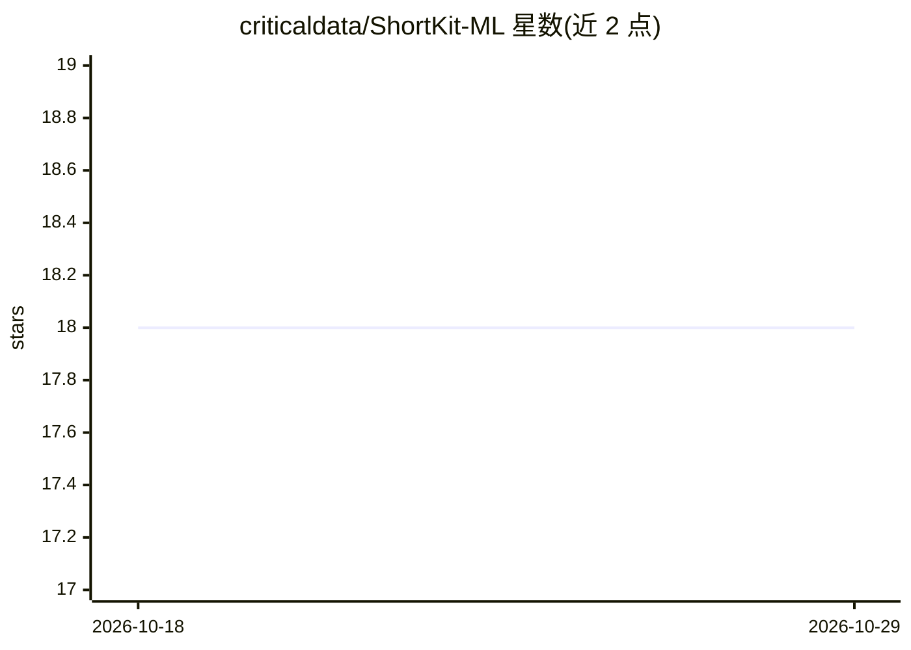

# criticaldata/ShortKit-ML

⭐ 18 · Python · MIT · 推送 2026-10-28 · [GitHub](https://github.com/criticaldata/ShortKit-ML) · [官网](https://criticaldata.github.io/ShortKit-ML/) · 组织维护

**检测与缓解机器学习嵌入空间中捷径与偏差的统一工具包**

面向医学影像等领域机器学习模型的研究工具包：提供 20+ 种捷径/偏差检测方法（HBAC、Probe、Statistical、Equalized Odds 等）、6 种缓解方法（Shortcut Masking、Adversarial Debiasing 等）与 5 种可插拔风险聚合条件，通过统一的 ShortcutDetector API 调用。支持多敏感属性同时检测、多嵌入模型对比、Embedding-Only 模式（无需模型本体）、Gradio 交互面板与 PDF/HTML/Markdown 报告。以 PyPI 包提供，附带 MCP 服务器供 AI 助手调用，基准数据集托管于 HuggingFace（PhysioNet 受限访问）。

## 筛选速览

| 维度 | 判定 | 备注 |
|---|---|---|
| AI 角色 | `ai-ecosystem` | LLM/agent 周边工具 |
| 许可风险 | `permissive` | MIT |
| 部署形态 | `self-host` | docker 或自建部署 |
| 模型依赖 | — | README 未给出锁定关系 |
| 硬件要求 | — | 无带数字的原话,不猜 |
| 安装摩擦 | `low` | 无编译、无系统依赖或容器化 |
| 成熟度 | — | 结构信号不足 |

## 能力要点

- 20+ 检测方法与 6 种缓解方法，统一 ShortcutDetector API
- Embedding-Only 模式：仅需嵌入向量，支持闭源模型
- 多敏感属性同时检测与多嵌入模型对比模式
- 内置 MCP 服务器，可被 Claude、Cursor、Copilot 等 AI 助手直接调用

## 适用场景

- 医学影像模型上线前审计嵌入空间中的捷径与偏差
- 同时测试种族、性别、年龄等多个敏感属性的公平性
- 对比多个嵌入模型在捷径学习上的表现
- 复现论文的合成数据与 CheXpert/MIMIC-CXR 基准实验

## 场景标签

`模型评测` · 领域:评测与运维

## 证据(README 行号)

> L3: > **ShortKit-ML** detects and mitigates shortcuts and biases in machine learning embedding spaces. 20+ detection and
> L19: - **20+ detection methods**: HBAC, Probe, Statistical, Geometric, Bias Direction PCA, Equalized Odds, Demographic P
> L25: - Interactive Gradio dashboard with real-time analysis

## 星数曲线

2026-10-18 18 → 2026-10-29 18（+0）

---
*卡片 v1 · prompt 1.4 · 生成 2026-10-29 · 置信度 high · 依据 README sha `d5540d4cd87e` · [字段定义](../../DATASET.md)*
