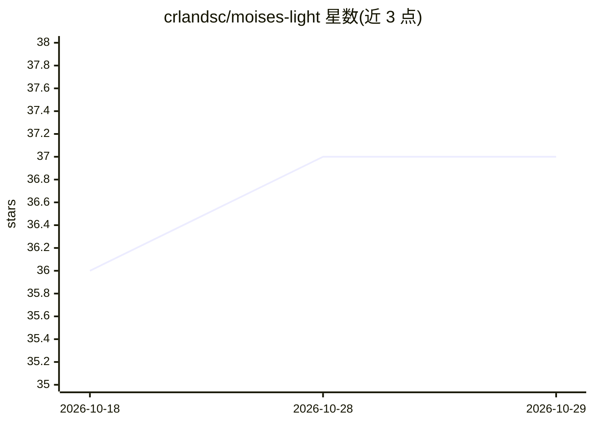

# crlandsc/moises-light

⭐ 37 · Python · MIT · 推送 2026-05-01 · [GitHub](https://github.com/crlandsc/moises-light) · [官网](https://arxiv.org/abs/2510.06785) · 个人维护

**音乐源分离模型 Moises-Light 架构的 PyTorch 实现**

Moises-Light 论文（WASPAA 2025）的非官方 PyTorch 实现，论文未公开代码，基于论文描述与 DTTNet、BS-RoFormer、SCNet 等开源实现独立完成。模型为带状分组卷积的 U-Net，输入立体声混音，输出人声/鼓/贝斯/其他四分轨；提供 paper 忠实版（截断至 14.7 kHz）与全频带扩展预设（0-22 kHz），参数量约 256 万至 970 万。含掩码生成、Z-score 归一化等实现取舍说明，供研究者训练与复现使用。

## 筛选速览

| 维度 | 判定 | 备注 |
|---|---|---|
| AI 角色 | `ai-native` | 本体是模型或模型工具 |
| 许可风险 | `permissive` | MIT |
| 部署形态 | `library` | 以包/库形式分发 |
| 模型依赖 | — | README 未给出锁定关系 |
| 硬件要求 | — | 无带数字的原话,不猜 |
| 安装摩擦 | `low` | 无编译、无系统依赖或容器化 |
| 成熟度 | — | 结构信号不足 |

## 能力要点

- 四分轨音乐源分离，多种预设（paper 忠实版与全频带版）
- 分组卷积带状分割 + 双路径 RoPE transformer 瓶颈的非对称 U-Net
- 详细披露与论文不同之处的实现决策（掩码生成、多 stem 共享编码器等）
- pip 安装，PyTorch>=2.0 依赖

## 适用场景

- 把混音拆分成人声、鼓、贝斯、其他分轨
- 复现或改进 Moises-Light 论文架构
- 在全频带范围内做源分离实验

## 场景标签

`模型训练` · 领域:训练与推理

## 证据(README 行号)

> L5: This is an unofficial PyTorch implementation of the Moises-Light architecture from "Moises-Light: Resource-efficient
> L46: All presets use `n_fft=6144`, `hop_size=1024`, stereo input, and 4-stem output (vocals, drums, bass, other).

## 星数曲线

2026-10-18 36 → 2026-10-29 37（+1）

---
*卡片 v1 · prompt 1.4 · 生成 2026-10-25 · 置信度 high · 依据 README sha `07bfc391a6ee` · [字段定义](../../DATASET.md)*
