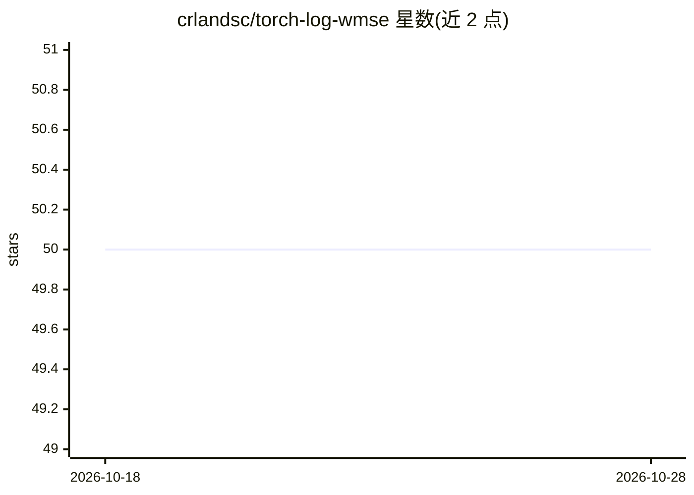

# crlandsc/torch-log-wmse

⭐ 50 · Python · Apache-2.0 · 推送 2026-09-01 · [GitHub](https://github.com/crlandsc/torch-log-wmse) · 组织维护

**音频质量度量与损失函数 logWMSE 的 PyTorch 实现**

提供 Iver Jordal 提出的 logWMSE 音频质量度量的 torch 实现，计算频率加权 MSE 的对数，可作为损失函数训练音频分离与降噪模型。支持数字静音目标，采用三输入设计（未处理/已处理/目标音频）以度量衰减并实现联合增益不变性；内置按人耳敏感度的频率加权（按 44.1kHz 设计，可重采样到其他采样率，分数内部一致而非跨采样率可比）。README 声明其为感知性目标而非信号保真目标，训练时需梯度裁剪。

## 筛选速览

| 维度 | 判定 | 备注 |
|---|---|---|
| AI 角色 | `ai-native` | 本体是模型或模型工具 |
| 许可风险 | `permissive` | Apache-2.0 |
| 部署形态 | `library` | 以包/库形式分发 |
| 模型依赖 | — | README 未给出锁定关系 |
| 硬件要求 | — | 无带数字的原话,不猜 |
| 安装摩擦 | `low` | 无编译、无系统依赖或容器化 |
| 成熟度 | — | 结构信号不足 |

## 能力要点

- 支持数字静音目标的音频质量度量
- LogWMSE/LogWMSELoss 双形态：正向度量与可最小化损失
- 三输入设计与联合增益尺度不变性
- 频率加权按 44.1kHz 设计，支持 torch.autocast 混合精度

## 适用场景

- 训练音频源分离或降噪模型时用作损失函数
- 评测音频分离/降噪系统的输出质量
- 处理包含数字静音片段的音频评估场景

## 场景标签

`模型评测` · 领域:评测与运维

## 证据(README 行号)

> L5: This repository contains the torch implementation of an audio quality metric, logWMSE, originally proposed by Iver J
> L7: logWMSE is a custom metric and loss function for audio signals that calculates the logarithm (log) of a frequency-we

## 星数曲线

2026-10-18 50 → 2026-10-28 50（+0）

---
*卡片 v1 · prompt 1.4 · 生成 2026-10-24 · 置信度 high · 依据 README sha `ff60a89615aa` · [字段定义](../../DATASET.md)*
