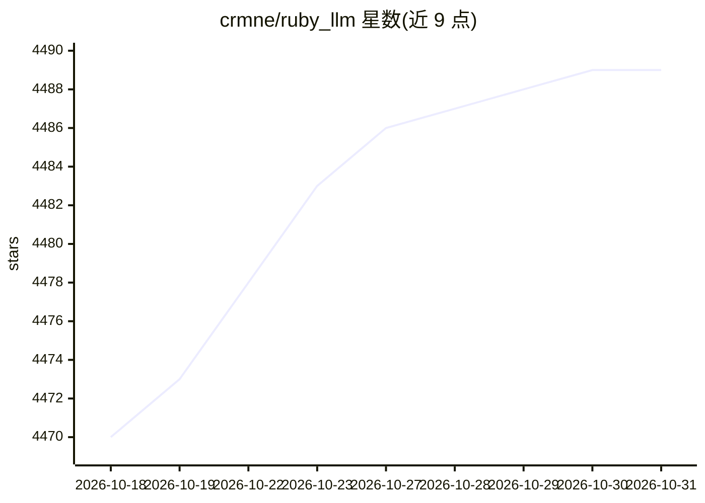

# crmne/ruby_llm

⭐ 4,489 · Ruby · MIT · 推送 2026-10-28 · [GitHub](https://github.com/crmne/ruby_llm) · [官网](https://rubyllm.com/) · 组织维护

**Ruby 语言的 AI 应用开发框架：统一 API 接入多家模型**

面向 Ruby/Rails 开发者的 AI 框架，以一套一致 API 覆盖 19 家模型提供商及任意 OpenAI 兼容端点，支持在托管与本地提供商间切换而无需改写应用。功能包括聊天、图像/视频生成、语音转写与合成、OCR、嵌入、重排序、审核、结构化输出、Agent、MCP 连接、沙箱代码执行、评测与 Rails 集成（Active Record 持久化、Hotwire 流式、生成器）。以 Ruby gem 形式安装，评测与技能等部分功能标注仅在 main 分支可用。

## 筛选速览

| 维度 | 判定 | 备注 |
|---|---|---|
| AI 角色 | `ai-ecosystem` | LLM/agent 周边工具 |
| 许可风险 | `permissive` | MIT |
| 部署形态 | `None` |  |
| 模型依赖 | local-ok | 支持本地模型 |
| 硬件要求 | — | 无带数字的原话,不猜 |
| 安装摩擦 | `low` | 无编译、无系统依赖或容器化 |
| 成熟度 | — | 结构信号不足 |

## 能力要点

- 19 家提供商统一 API，含 Ollama 等本地运行时与 OpenAI 兼容端点
- 覆盖聊天、视觉、音频、OCR、嵌入、重排序、图像/视频生成的多模态能力
- Agent、MCP、沙箱代码执行、技能与评测框架
- Rails 集成：Active Record 持久化、Hotwire 流式与生成器

## 适用场景

- 在 Rails 应用中快速加入 AI 聊天与多模态功能
- 构建带工具调用与人工审批的 Agent
- 在不改代码的情况下切换或回退模型提供商
- 用数据集对 Agent 行为做评测

## 场景标签

`Agent 框架` `模型网关` · 领域:Agent 开发

## 证据(README 行号)

> L5:  Build AI features the Ruby way: models, tools, agents, sandboxed code, evaluations, and Rails conventions, designed
> L31: More than a client for model APIs. RubyLLM gives your application the conventions, the runtime, and every piece in 

## 星数曲线

2026-10-18 4,470 → 2026-10-31 4,489（+19）

---
*卡片 v1 · prompt 1.4 · 生成 2026-10-20 · 置信度 high · 依据 README sha `81b41c271bec` · [字段定义](../../DATASET.md)*
