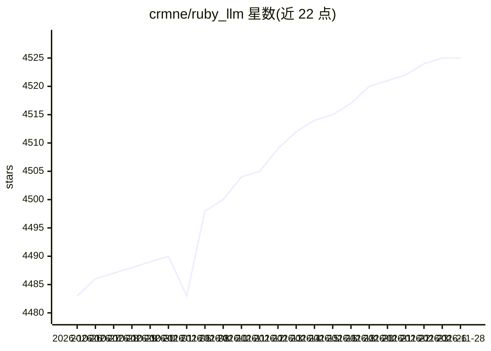

# crmne/ruby_llm

⭐ 4,525 · Ruby · MIT · 推送 2026-11-26 · [GitHub](https://github.com/crmne/ruby_llm) · [官网](https://rubyllm.com/) · 个人维护

**Ruby 生态的统一 AI 框架：一套 API 接入 23 家模型提供商**

面向 Ruby/Rails 开发者的 AI 框架，提供对话、流式输出、多模态附件、工具调用、Agent、评估（Evaluation）、图像/视频生成、转录、OCR、嵌入与重排等能力，均通过统一 API 调用。支持 23 家提供商并兼容 OpenAI 兼容端点，可在托管与本地提供商间切换。Rails 集成提供 Active Record 持久化、Hotwire 流式与生成器；附带成本追踪与 OpenTelemetry 观测。通过 RubyGems 安装（bundle add ruby_llm），当前版本 2.2.3。

## 筛选速览

| 维度 | 判定 | 备注 |
|---|---|---|
| AI 角色 | `ai-ecosystem` | LLM/agent 周边工具 |
| 许可风险 | `permissive` | MIT |
| 部署形态 | `None` |  |
| 模型依赖 | local-ok | 支持本地模型 |
| 硬件要求 | — | 无带数字的原话,不猜 |
| 安装摩擦 | `low` | 无编译、无系统依赖或容器化 |
| 成熟度 | — | 结构信号不足 |

## 能力要点

- 统一 API 接入 23 家提供商，含本地 Ollama 与 OpenAI 兼容端点
- 工具调用、Agent、多 Agent 工作流与 MCP 服务器集成
- 内置评估框架：数据集 + 模型评审 + Ruby 断言，可从 RSpec/Rake 运行
- Rails 集成：acts_as_chat 持久化、Hotwire 流式、生成器一键搭建聊天 UI

## 适用场景

- 在 Rails 应用中快速加入对话式 AI 功能并持久化会话
- 在多家模型提供商之间切换而无需改写应用代码
- 为业务构建带工具调用与人工审批的 Agent
- 用评估数据集对比不同模型对业务问题的回答质量

## 场景标签

`Agent 框架` `模型评测` · 领域:Agent 开发

## 证据(README 行号)

> L3:  The Ruby AI framework
> L40: More than a client for model APIs. RubyLLM gives your application the conventions, the runtime, and every piece in 
> L87: * **Providers:** OpenAI, Azure, xAI, Anthropic, Gemini, VertexAI, Bedrock, Cohere, DeepSeek, Hetzner, Meta, MiniMax

## 星数曲线

2026-10-26 4,483 → 2026-11-28 4,525（+42）

---
*卡片 v1 · prompt 1.4 · 生成 2026-11-22 · 置信度 high · 依据 README sha `a867c94aca64` · [字段定义](../../DATASET.md)*
