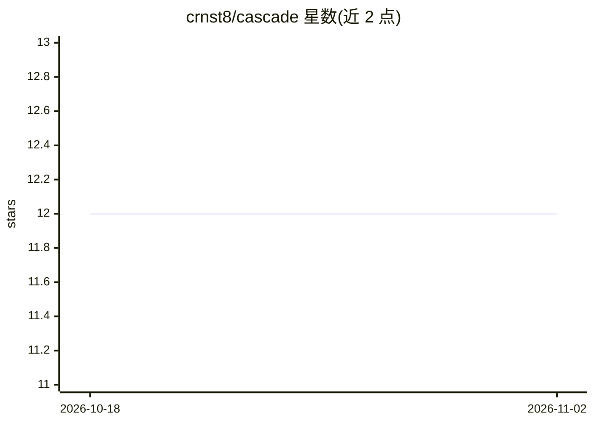

# crnst8/cascade

⭐ 12 · Python · MIT · 推送 2026-06-24 · [GitHub](https://github.com/crnst8/cascade) · 个人维护

**跨免费 API 层自动切换的 CLI 聊天工具**

单文件 Python 脚本，将聊天请求路由到 18 家免费层 API 提供商（Groq、Cerebras、Gemini、Mistral、OpenRouter 等）：发现可用模型并按模型家族、参数量、提供商速度排序，遇限流或配额错误自动冷却并切换下一个模型。提供交互式 CLI、Python API 与 OpenAI 兼容本地服务器，内置基准测速与本地用量跟踪。仅依赖 Python 3，无需 pip install；OVHcloud 无需 key 即可运行。

## 筛选速览

| 维度 | 判定 | 备注 |
|---|---|---|
| AI 角色 | `ai-ecosystem` | LLM/agent 周边工具 |
| 许可风险 | `permissive` | MIT |
| 部署形态 | `library` | 以包/库形式分发 |
| 模型依赖 | locked-api |  |
| 硬件要求 | — | 无带数字的原话,不猜 |
| 安装摩擦 | `low` | 无编译、无系统依赖或容器化 |
| 成熟度 | — | 结构信号不足 |

## 能力要点

- 18 家免费层提供商接入，按 key 自动启用
- 限流/配额/临时错误时自动故障切换到下一模型
- OpenAI 兼容 HTTP 服务器模式（/v1/chat/completions，支持流式）
- /bench 测速后可按实测吞吐排序路由

## 适用场景

- 免费层 API 之间自动切换，避免单家限流中断聊天
- 作为 OpenAI 兼容端点给其他工具提供兜底推理
- 对比各家免费模型的延迟与吞吐

## 场景标签

`模型网关` `聊天机器人` · 领域:Agent 开发

## 证据(README 行号)

> L6: `cascade` is a single Python script that routes chat requests across free-tier API providers.
> L85: python3 cascade.py --serve     # OpenAI-compatible HTTP server

## 星数曲线

2026-10-18 12 → 2026-11-02 12（+0）

---
*卡片 v1 · prompt 1.4 · 生成 2026-11-01 · 置信度 mid · 依据 README sha `859a9d2a7145` · [字段定义](../../DATASET.md)*
