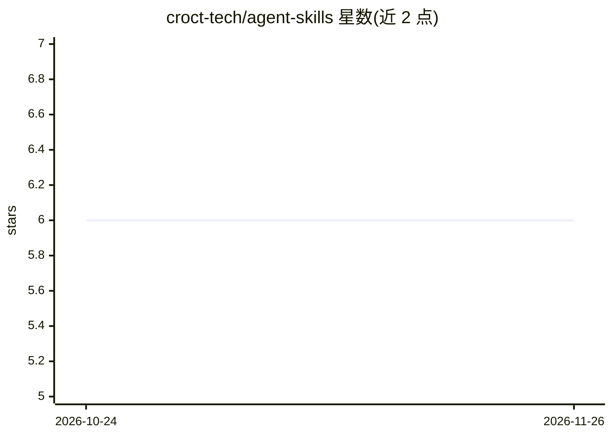

# croct-tech/agent-skills

⭐ 6 · TypeScript · MIT · 推送 2026-11-09 · [GitHub](https://github.com/croct-tech/agent-skills) · [官网](https://docs.croct.com) · 组织维护

**为 AI 编码代理注入 Croct 个性化与 A/B 测试技能包**

该仓库将 Croct 官方文档整理为 Agent Skills 包，供 Claude Code、Cursor、Codex 等编码代理加载，使其掌握 Croct SDK 集成、CLI 使用、内容建模、CQL 受众查询、事件跟踪与实验规划等知识。提供三种安装路径：skills CLI、Claude Code 插件市场、Codex 插件市场，亦支持手动复制 skills 目录。每个 skill 均标注来源文档页，未覆盖内容会指引代理读取在线 markdown 文档。

## 筛选速览

| 维度 | 判定 | 备注 |
|---|---|---|
| AI 角色 | `ai-knowledge` | 知识聚合/清单类 |
| 许可风险 | `permissive` | MIT |
| 部署形态 | `library` | 以包/库形式分发 |
| 模型依赖 | — | README 未给出锁定关系 |
| 硬件要求 | — | 无带数字的原话,不猜 |
| 安装摩擦 | `low` | 无编译、无系统依赖或容器化 |
| 成熟度 | — | 结构信号不足 |

## 能力要点

- 10 个 skill 覆盖 SDK 集成、CLI、内容建模、CQL、事件跟踪、API 调用等
- 支持 Claude Code 插件市场、Codex 插件市场与 skills CLI 三种安装方式
- skill 引用文件标注来源文档页，并可读取在线 markdown 文档补充
- Claude Code 插件附带 /croct 命令列出可用技能

## 适用场景

- 让编码代理在 Next.js 应用中集成 Croct 并渲染个性化内容
- 用自然语言创建访客受众和 A/B 实验配置
- 排查内容槽位显示 fallback 内容的问题
- 审计网站并生成个性化方案报告

## 场景标签

`编码 Agent` `提示工程` · 领域:Agent 开发

## 证据(README 行号)

> L21: This repository packages Agent Skills that give your AI coding agent
> L24: Every skill is derived from the official documentation at docs.croct.com.

## 星数曲线

2026-10-24 6 → 2026-11-26 6（+0）

---
*卡片 v1 · prompt 1.4 · 生成 2026-11-21 · 置信度 high · 依据 README sha `dabe568aefed` · [字段定义](../../DATASET.md)*
