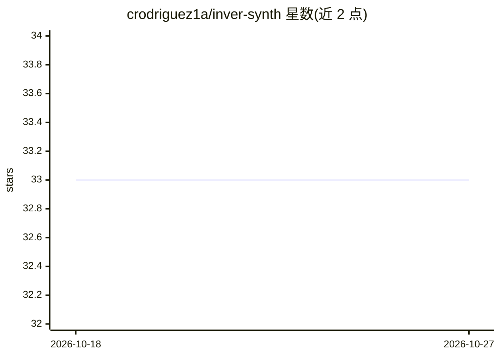

# crodriguez1a/inver-synth

⭐ 33 · Python · Apache-2.0 · 推送 2026-10-20 · [GitHub](https://github.com/crodriguez1a/inver-synth) · 个人维护

**从音频预测合成器参数的 InverSynth 方法 Python 实现**

InverSynth 论文（arXiv:1812.06349）的 Python 实现：给定音频片段，预测可重现该音色的合成器参数。当前版本以冻结的 CLAP（laion/clap-htsat-unfused）为骨干，配合纯 numpy 实现的 FM/波表/减法合成器生成训练数据，PyTorch 训练，48 kHz 采样率，内置提交的 fm2op 检查点（val MSE 0.035）可直接推理；推理时用重合成余弦相似度作为置信度指标。原始 TensorFlow CNN + VST/librenderman 实现保留在 bugfix/fc-layer 分支（仅限 Linux）。测试平台覆盖 Apple MPS、CPU 与 CUDA。

## 筛选速览

| 维度 | 判定 | 备注 |
|---|---|---|
| AI 角色 | `ai-native` | 本体是模型或模型工具 |
| 许可风险 | `permissive` | Apache-2.0 |
| 部署形态 | `None` |  |
| 模型依赖 | — | README 未给出锁定关系 |
| 硬件要求 | — | 无带数字的原话,不猜 |
| 安装摩擦 | `high` | 编译与系统依赖俱全 |
| 成熟度 | — | 结构信号不足 |

## 能力要点

- CLAP 冻结骨干 + 参数回归头预测合成器参数
- 4 种纯 numpy 合成器生成器（fm2op/fm/波表/减法）
- 提交 fm2op.pt 检查点，无需重新训练即可推理
- 重合成余弦相似度置信度指标与库级基准（mean 28.7%）

## 适用场景

- 给一段补丁音频，预测能重现其音色的合成器参数
- 作为合成器补丁搜索引擎的后端组件
- 复现或扩展 InverSynth 论文的深度估计方法

## 场景标签

 · 领域:音频/音乐信息检索

## 证据(README 行号)

> L7: A Python implementation of InverSynth (Barkan, Tsiris, Koenigstein, Katz, 2019).
> L8: Given an audio clip, predict the synthesizer parameters that would recreate it.
> L35: |Backbone|CNN trained from scratch|CLAP (`laion/clap-htsat-unfused`, frozen, 512-dim)|

## 星数曲线

2026-10-18 33 → 2026-10-27 33（+0）

---
*卡片 v1 · prompt 1.4 · 生成 2026-10-25 · 置信度 high · 依据 README sha `e1a6da1443f5` · [字段定义](../../DATASET.md)*
