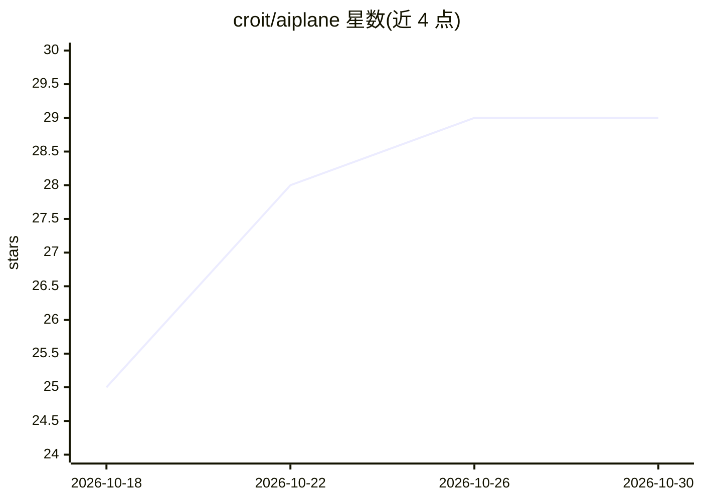

# croit/aiplane

⭐ 29 · Rust · AGPL-3.0 · 推送 2026-10-29 · [GitHub](https://github.com/croit/aiplane) · [官网](https://www.croit.io/solutions/aiplane) · 组织维护

**自托管 AI 平台：面向组织的模型网关、工作区与 agent 运行时**

AIplane 是 croit 维护的自托管 AI 基础设施，组合三部分：员工可日常使用的对话工作区（持久会话、文件与版本化文档、语音/图像、个人记忆与技能）、多后端模型网关（OpenAI 兼容与 Anthropic Messages API、模型池、别名路由、健康检查与重试）、服务端 agent 执行（agent 构建器、测试发布、MCP 工具、审批人机回路、定时与 webhook 触发）。管理侧提供 OIDC 身份、组权限、作用域 token、配额与合规控制。需外部 OpenID Connect 身份提供商和 OpenAI 兼容模型服务，不含用户名密码登录和模型服务器。AGPL-3.0-only。

## 筛选速览

| 维度 | 判定 | 备注 |
|---|---|---|
| AI 角色 | `ai-ecosystem` | LLM/agent 周边工具 |
| 许可风险 | `viral` | AGPL-3.0 |
| 部署形态 | `self-host` | docker 或自建部署 |
| 模型依赖 | — | README 未给出锁定关系 |
| 硬件要求 | — | 无带数字的原话,不猜 |
| 安装摩擦 | `low` | 无编译、无系统依赖或容器化 |
| 成熟度 | — | 结构信号不足 |

## 能力要点

- 多后端模型网关：模型池、别名路由、副本健康检查与故障重试
- OpenAI 兼容与 Anthropic Messages API 供现有应用接入
- 服务端 agent 执行：MCP 工具、审批流、定时/webhook 触发的个人 Dot
- OIDC 身份、组权限、作用域 token 与配额管理

## 适用场景

- 为组织统一接入多家模型后端并按策略路由
- 让员工在带权限控制的对话工作区使用模型与公司知识
- 构建、测试并发布带审批人机回路的业务 agent
- 通过 /v1 API 让现有应用以 token 接入受控模型与工具

## 场景标签

`模型网关` `Agent 框架` · 领域:Agent 开发

## 证据(README 行号)

> L38: - 🔀 **One model gateway across providers.** Connect hosted and self-hosted
> L171: Use the `/v1` API to connect existing software. AIplane supports OpenAI chat

## 星数曲线

2026-10-18 25 → 2026-10-30 29（+4）

---
*卡片 v1 · prompt 1.4 · 生成 2026-10-26 · 置信度 high · 依据 README sha `25bca5aa73ca` · [字段定义](../../DATASET.md)*
