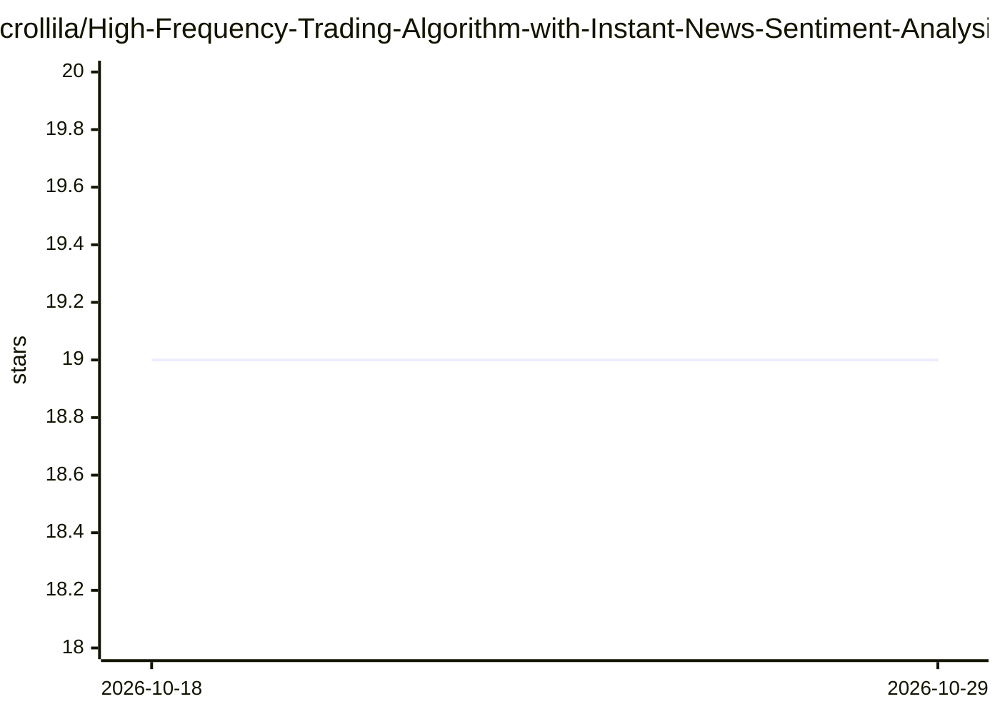

# crollila/High-Frequency-Trading-Algorithm-with-Instant-News-Sentiment-Analysis

⭐ 19 · JavaScript · 推送 2026-08-12 · [GitHub](https://github.com/crollila/High-Frequency-Trading-Algorithm-with-Instant-News-Sentiment-Analysis) · 个人维护

**面向开发者的 AI 新闻高频交易机器人：新闻→GPT 情绪评分→自动下单**

基于 Node.js 的自动化股票交易程序：通过 Benzinga News 接收实时新闻，将文章数据发送至 GPT 模型获得 0-100 情绪评分，据此由算法决定 BUY/SELL/SHORT/COVER 与仓位大小，经 Alpaca Trade API 执行，README 称新闻到下单耗时 5-70ms。附流动性过滤、止盈阈值、5% 应急卖出等风控参数，支持盘前盘后交易。运行需自备 OpenAI、Alpaca、Benzinga、FMP 四个账户的 API Key，仅在 Alpaca paper trading 中测试。

## 筛选速览

| 维度 | 判定 | 备注 |
|---|---|---|
| AI 角色 | `ai-native` | 本体是模型或模型工具 |
| 许可风险 | `none` | — |
| 部署形态 | `library` | 以包/库形式分发 |
| 模型依赖 | — | README 未给出锁定关系 |
| 硬件要求 | — | 无带数字的原话,不猜 |
| 安装摩擦 | `low` | 无编译、无系统依赖或容器化 |
| 成熟度 | — | 结构信号不足 |

## 能力要点

- 新闻事件经 GPT 模型产生 0-100 情绪评分，驱动 BUY/SELL/SHORT/COVER 决策
- README 称新闻发布到成交耗时 5-70ms
- 可调参数：止盈阈值、流动性要求、应急卖出比例、保证金/做空
- 支持盘前盘后交易与实时价格更新

## 适用场景

- 在 Alpaca paper trading 上测试新闻驱动的自动化交易策略
- 按情绪评分与风控阈值自动执行多空交易
- 实时记录评分与股价日志用于策略调优

## 场景标签

`金融量化` · 领域:学习与行业

## 证据(README 行号)

> L14: This is my AI high frequency trading algorithm, a Node.js project that uses the Alpaca Trade API for trading activi
> L8: > Developed a systematic equity strategy designed to identify and trade market-moving news. Built automated news ing

## 星数曲线

2026-10-18 19 → 2026-10-29 19（+0）

---
*卡片 v1 · prompt 1.4 · 生成 2026-10-28 · 置信度 high · 依据 README sha `d205a6249cf6` · [字段定义](../../DATASET.md)*
