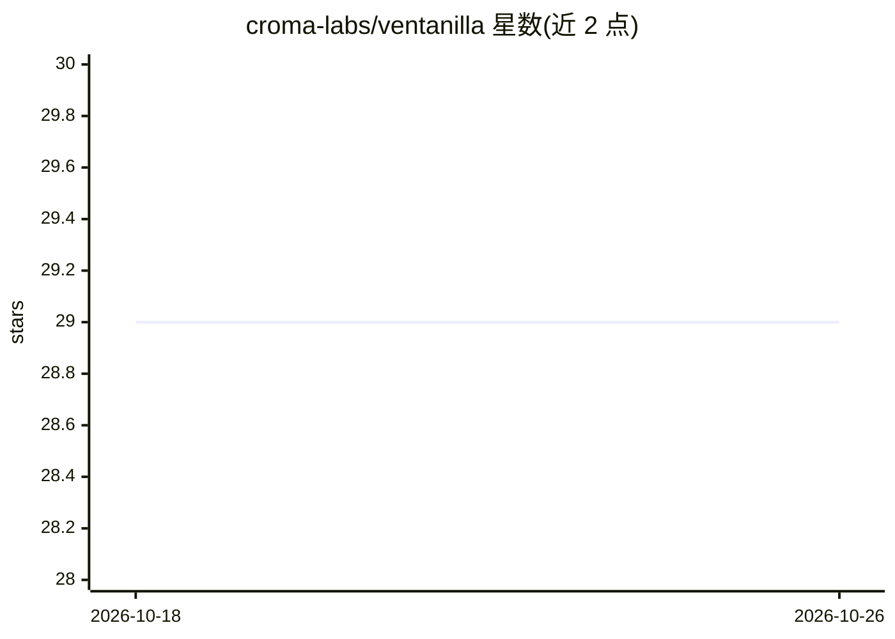

# croma-labs/ventanilla

⭐ 29 · TypeScript · MIT · 推送 2026-10-19 · [GitHub](https://github.com/croma-labs/ventanilla) · [官网](https://gov.usecroma.com) · 组织维护

**面向公众的哥伦比亚/萨尔瓦多政府服务问答站，答案仅引官方来源**

由 Croma Labs 维护的 civic-tech 问答网站：用户提问政府服务（tramites）相关问题，系统先检索官方来源，起草答案后逐条核验声明，仅输出经确认并附引用的内容。部署依赖 Croma API 与 Groq API key，需 Node 24；按国家组织（哥伦比亚 gov.co/DIAN 等、萨尔瓦多 gob.sv 等），支持通过目录复制添加国家。声明无 cookie、无追踪，并在发送前屏蔽个人身份数据。非官方网站。

## 筛选速览

| 维度 | 判定 | 备注 |
|---|---|---|
| AI 角色 | `ai-native` | 本体是模型或模型工具 |
| 许可风险 | `permissive` | MIT |
| 部署形态 | `library` | 以包/库形式分发 |
| 模型依赖 | locked-api |  |
| 硬件要求 | — | 无带数字的原话,不猜 |
| 安装摩擦 | `low` | 无编译、无系统依赖或容器化 |
| 成熟度 | — | 结构信号不足 |

## 能力要点

- 检索官方来源→起草→逐条核验→仅输出已确认内容并引用
- 按国家组织：哥伦比亚与萨尔瓦多各自的官方来源语料
- 发送前阻断身份证号、电话等个人数据
- 无 cookie、无分析、无追踪

## 适用场景

- 查询哥伦比亚或萨尔瓦多的政府服务办理流程
- 获得带官方来源引用的政务答案
- 参照国家目录结构复制扩展到其他国家

## 场景标签

`聊天机器人` · 领域:对话与助手

## 证据(README 行号)

> L3: Answers about government services, from official sources only.
> L21: 1. Search official sources.

## 星数曲线

2026-10-18 29 → 2026-10-26 29（+0）

---
*卡片 v1 · prompt 1.4 · 生成 2026-10-26 · 置信度 high · 依据 README sha `db88db0ad597` · [字段定义](../../DATASET.md)*
