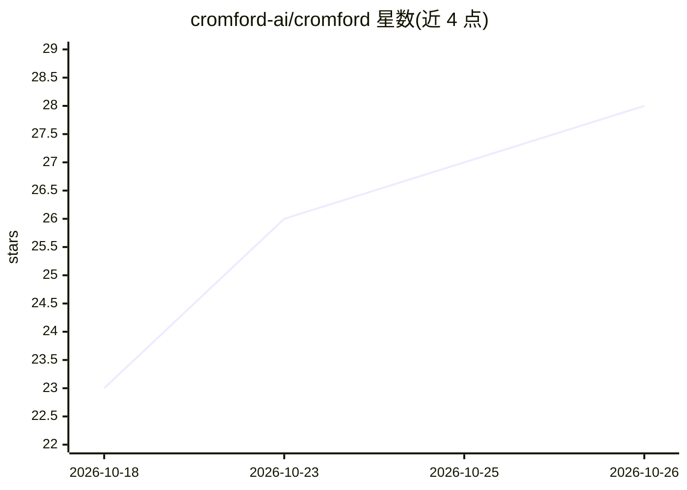

# cromford-ai/cromford

⭐ 28 · Shell · Apache-2.0 · 推送 2026-10-25 · [GitHub](https://github.com/cromford-ai/cromford) · [官网](https://cromford.dev) · 组织维护

**无人值守的开源软件工厂：从工单到合并部署全自动**

面向开发者与团队的自托管软件交付流水线：读取产品看板工单，经 triage/plan/build/review/preview QA/merge/deploy-verify/post-merge QA 八个固定阶段处理，每阶段有独立 runner、模型与预算，最终确认变更确实上线。机制上坚持脚本能判定的不用 LLM，多供应商模型按 claude→grok→openrouter→fireworks 固定阶梯降级，每次调用记录成本，重复的评审发现被挖掘为 CI 护栏。自托管通过 fork 仓库并复制 selfhost.conf 模板配置，安装器的 --apply 步骤尚未实现，资源需手工创建。

## 筛选速览

| 维度 | 判定 | 备注 |
|---|---|---|
| AI 角色 | `ai-ecosystem` | LLM/agent 周边工具 |
| 许可风险 | `permissive` | Apache-2.0 |
| 部署形态 | `None` |  |
| 模型依赖 | locked-api |  |
| 硬件要求 | — | 无带数字的原话,不猜 |
| 安装摩擦 | `low` | 无编译、无系统依赖或容器化 |
| 成熟度 | `idea` | |

## 能力要点

- 八个固定阶段的工单→合并→部署验证流水线，无人值守运行
- 多供应商模型降级阶梯：claude→grok→openrouter→fireworks
- 每次 LLM 调用写入 cost.csv 计价并按 PR 汇总
- 评审发现自动挖掘为 CI 护栏规则（rule-miner）

## 适用场景

- 让 AI coding agent 无人值守地完成从工单到上线的完整闭环
- 为团队搭建带对抗性评审与合并分级的自动化交付流水线
- 追踪每个 PR 的 LLM 调用成本

## 场景标签

`编码 Agent` `代码审查` · 领域:编码与开发

## 证据(README 行号)

> L3: Cromford is the open-source software factory (cromford.dev). It takes tickets off a product board,
> L16: One ticket moves through fixed stages. Each has its own runner, its own model,
> L61: claude → grok → codex-configured openrouter → fireworks — alerting as it

## 星数曲线

2026-10-18 23 → 2026-10-26 28（+5）

---
*卡片 v1 · prompt 1.4 · 生成 2026-10-26 · 置信度 high · 依据 README sha `104a085fdb7b` · [字段定义](../../DATASET.md)*
