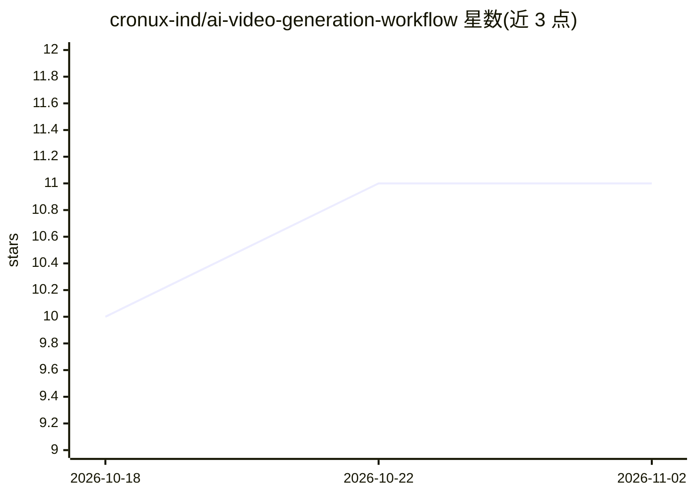

# cronux-ind/ai-video-generation-workflow

⭐ 11 · TypeScript · MIT · 推送 2026-10-12 · [GitHub](https://github.com/cronux-ind/ai-video-generation-workflow) · 个人维护

**Windows 桌面工具：脚本+幻灯片生成带配音字幕的视频**

面向无需编程知识的普通用户的 Windows 视频生成应用：用户输入文字脚本并上传幻灯片图片，应用通过内置 TTS 生成多语音朗读、自动生成与音频同步的字幕，再用 FFmpeg 将幻灯片、音频与字幕渲染为 MP4 视频。以 exe 安装包或 zip 分发，FFmpeg 二进制随安装包附带，无需单独安装。要求 Windows 10 及以上、8 GB 内存与 10 GB 磁盘空间。README 描述其为分步向导式工作流，未说明所用 AI 服务的具体提供方或模型。

## 筛选速览

| 维度 | 判定 | 备注 |
|---|---|---|
| AI 角色 | `ai-native` | 本体是模型或模型工具 |
| 许可风险 | `permissive` | MIT |
| 部署形态 | `desktop` | 安装包/桌面程序 |
| 模型依赖 | — | README 未给出锁定关系 |
| 硬件要求 | — | 无带数字的原话,不猜 |
| 安装摩擦 | `medium` | 含编译或系统依赖之一 |
| 成熟度 | — | 结构信号不足 |

## 能力要点

- 脚本到多语音 TTS 朗读的自动生成
- 自动字幕生成并支持编辑时间与文本
- FFmpeg 渲染输出 MP4，FFmpeg 随安装包附带
- 分步向导式工作流，无需编程知识

## 适用场景

- 把文字脚本和幻灯片做成配音讲解视频
- 自动为视频生成同步字幕
- 批量制作短解说视频并导出 MP4 分享

## 场景标签

`语音合成` `视频生成` · 领域:内容生成

## 证据(README 行号)

> L7: This tool helps you create videos using artificial intelligence. It combines a script, slides, text-to-speech (TTS),
> L80: - **Text-to-Speech (TTS)**: Converts your script to voice narration automatically.

## 星数曲线

2026-10-18 10 → 2026-11-02 11（+1）

---
*卡片 v1 · prompt 1.4 · 生成 2026-11-02 · 置信度 mid · 依据 README sha `15b055ac1fff` · [字段定义](../../DATASET.md)*
