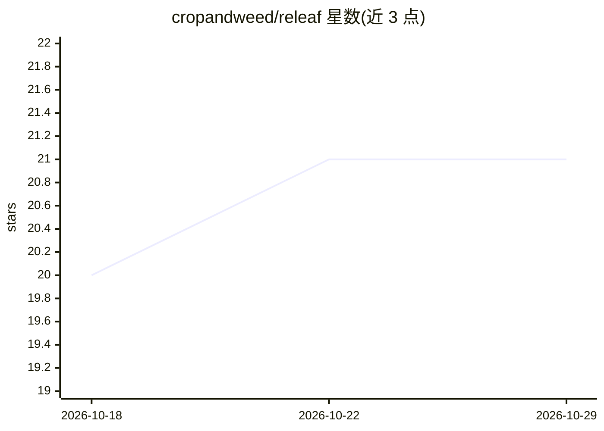

# cropandweed/releaf

⭐ 21 · Python · NOASSERTION · 推送 2026-09-28 · [GitHub](https://github.com/cropandweed/releaf) · 组织维护

**植物叶片实例分割框架：统一训练评测多架构模型，附基准数据集**

CVPR 2026 Agriculture-Vision Workshop 论文配套框架，提供叶片级实例分割的训练、评测与演示统一接口，集成 YOLO26（S/M/L）、Detectron2（ResNet-50/101、ResNeXt）与 RF-DETR 变体，便于在任意输入数据上比较不同模型与配置。评测基于 pycocotools 计算 COCO mAP、SBD、P/R/F1 与推理速度，附 CropAndWeedAndLeaf 基准数据集（Zenodo 下载，提供 YOLO 转 COCO 脚本）。以源码克隆方式使用，采用 CC BY-NC-SA 4.0 许可（非商业）。

## 筛选速览

| 维度 | 判定 | 备注 |
|---|---|---|
| AI 角色 | `ai-native` | 本体是模型或模型工具 |
| 许可风险 | `none` | NOASSERTION |
| 部署形态 | `None` |  |
| 模型依赖 | — | README 未给出锁定关系 |
| 硬件要求 | — | 无带数字的原话,不猜 |
| 安装摩擦 | `low` | 无编译、无系统依赖或容器化 |
| 成熟度 | — | 结构信号不足 |

## 能力要点

- 统一接口训练/评测/演示 YOLO26、Detectron2、RF-DETR 三类架构变体
- 评测输出 COCO mAP、SBD、P/R/F1 及推理时间（ms/img、FPS）
- 配套 CropAndWeedAndLeaf 叶片分割基准数据集及格式转换脚本
- 兼容 PhenoBench、LSC、Komatsuna、GrowliFlower 等叶片数据集

## 适用场景

- 农业场景下对叶片做实例分割与计数
- 在统一环境下比较不同分割架构的性能
- 使用 CropAndWeedAndLeaf 数据集做叶片分割基准评测

## 场景标签

`目标检测` `模型评测` · 领域:评测与运维

## 证据(README 行号)

> L5: ReLeaf is a comprehensive framework for leaf segmentation providing a unified interface for training and evaluating 
> L32: `demo.py` is the central tool for generating predictions with trained models. It supports all integrated frameworks

## 星数曲线

2026-10-18 20 → 2026-10-29 21（+1）

---
*卡片 v1 · prompt 1.4 · 生成 2026-10-28 · 置信度 high · 依据 README sha `bfbf1e93633b` · [字段定义](../../DATASET.md)*
