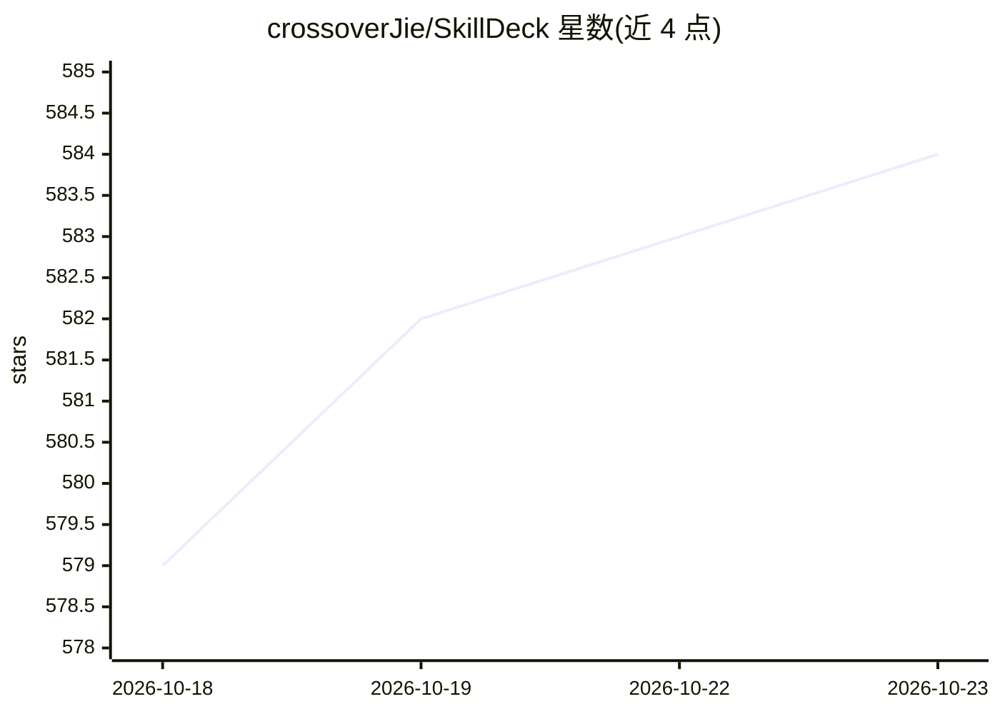

# crossoverJie/SkillDeck

⭐ 584 · Swift · MIT · 推送 2026-10-22 · [GitHub](https://github.com/crossoverJie/SkillDeck) · [官网](http://crossoverjie.top/SkillDeck/) · 个人维护 · 中文 README

**macOS 桌面 GUI：统一管理多个 AI 编码代理的技能**

SwiftUI 编写的 macOS 原生应用，为 12 种 AI 代码代理（Claude Code、Codex、Gemini CLI、Copilot CLI、Cursor 等）提供技能的统一管理：以文件系统为数据库，通过符号链接把技能目录挂载到各代理的 skills 路径，支持从 GitHub 或本地文件夹导入、更新检测、SKILL.md 编辑器与代理分配。内置 skills.sh 与 ClawHub 技能市场浏览，附赠可用自然语言管理技能的 skilldeck 技能。要求 macOS 14+，提供通用二进制与 Homebrew 安装，应用未签名。

## 筛选速览

| 维度 | 判定 | 备注 |
|---|---|---|
| AI 角色 | `ai-ecosystem` | LLM/agent 周边工具 |
| 许可风险 | `permissive` | MIT |
| 部署形态 | `desktop` | 安装包/桌面程序 |
| 模型依赖 | — | README 未给出锁定关系 |
| 硬件要求 | — | 无带数字的原话,不猜 |
| 安装摩擦 | `low` | 无编译、无系统依赖或容器化 |
| 成熟度 | — | 结构信号不足 |

## 能力要点

- 支持 12 种 AI 代码代理的技能统一管理与符号链接分配
- SKILL.md 分栏编辑器与实时预览
- skills.sh 排行榜与 ClawHub 目录浏览、搜索过滤
- 内置 skilldeck 技能，可在任意 AI 代理中用自然语言增删改技能

## 适用场景

- 在多个 AI 编码代理间共享和分配同一套技能
- 不想手动编辑文件和符号链接，用 GUI 安装更新技能
- 浏览 skills.sh / ClawHub 技能市场并一键导入

## 场景标签

`提示工程` · 领域:Agent 开发

## 证据(README 行号)

> L15: **SkillDeck** is the first desktop GUI for managing skills across multiple AI code agents — Claude Code, Codex, Gem
> L27: - **Multi-Agent Support** — Claude Code, Codex, Gemini CLI, Copilot CLI, OpenCode, Antigravity, Cursor, Kiro, CodeB

## 星数曲线

2026-10-18 579 → 2026-10-23 584（+5）

---
*卡片 v1 · prompt 1.4 · 生成 2026-10-21 · 置信度 high · 依据 README sha `3a31f4ea2610` · [字段定义](../../DATASET.md)*
