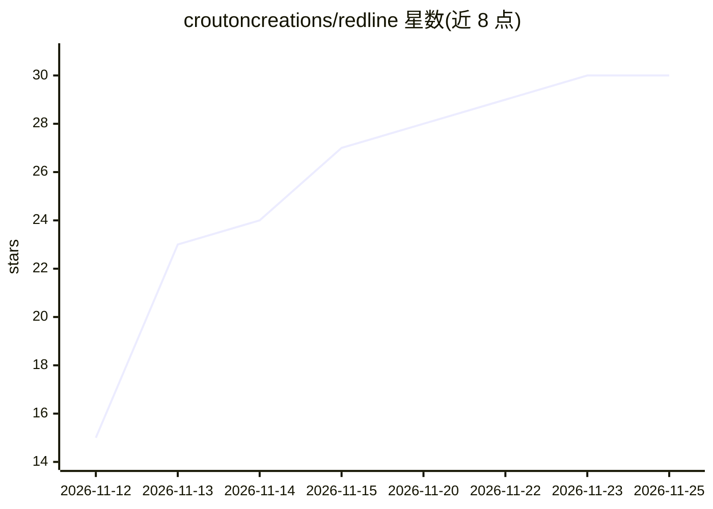

# croutoncreations/redline

⭐ 30 · Go · Apache-2.0 · 推送 2026-11-22 · [GitHub](https://github.com/croutoncreations/redline) · [官网](https://croutoncreations.com/blog/introducing-redline) · 个人维护

**macOS 菜单栏调度器：监控 Codex/Claude 配额并自动执行排队任务**

面向付费订阅 Codex 或 Claude 的开发者：Redline 读取 5 小时与每周配额窗口（复用本地 OpenUsage API 或原生采集），按策略对比剩余额度与剩余时间，在额度即将作废时自动调度排队任务，调用 Codex CLI、Claude Code、Pi 等 harness 执行。每个决策记录 RUN/WAIT/UNKNOWN 及理由；任务在 Git worktree 或 DevX 隔离会话中运行，保留结果、产物与日志。提供 macOS 菜单栏应用、跨平台 CLI、HTTP API 与 MCP server，仅本地运行（回环服务 + SQLite，无云端）。自动调度默认关闭，Windows 支持较新。

## 筛选速览

| 维度 | 判定 | 备注 |
|---|---|---|
| AI 角色 | `ai-ecosystem` | LLM/agent 周边工具 |
| 许可风险 | `permissive` | Apache-2.0 |
| 部署形态 | `library` | 以包/库形式分发 |
| 模型依赖 | — | README 未给出锁定关系 |
| 硬件要求 | — | 无带数字的原话,不猜 |
| 安装摩擦 | `low` | 无编译、无系统依赖或容器化 |
| 成熟度 | `idea` | |

## 能力要点

- 监控 Codex/Claude 的 5 小时与每周配额窗口，按 pace gap 决策调度
- 每个决策记录 RUN/WAIT/UNKNOWN 与解释，遥测过期时倾向等待
- 任务在 Git worktree 或 DevX 会话中隔离执行，保留结果与产物
- 内置 MCP server，供 Codex、Claude Code、Pi 在对话中查询与入队

## 适用场景

- 订阅额度即将重置时自动消耗，避免配额浪费
- 把测试补齐、重构、依赖升级等积压任务排队等待额度空闲
- 在对话中让编码 agent 查询配额与队列状态

## 场景标签

`工作流自动化` · 领域:效率与自动化

## 证据(README 行号)

> L22: you're comfortably behind on usage or running out of time before a reset, Redline fires up one of
> L36: - **Works with your agents.** Codex CLI, Claude Code, Pi, Hermes, or any command. Redline does
> L133:  launches the *harness* - the coding-agent CLI the job's execution profile names. One job at a

## 星数曲线

2026-11-12 15 → 2026-11-25 30（+15）

---
*卡片 v1 · prompt 1.4 · 生成 2026-11-18 · 置信度 high · 依据 README sha `e707cf0c655d` · [字段定义](../../DATASET.md)*
