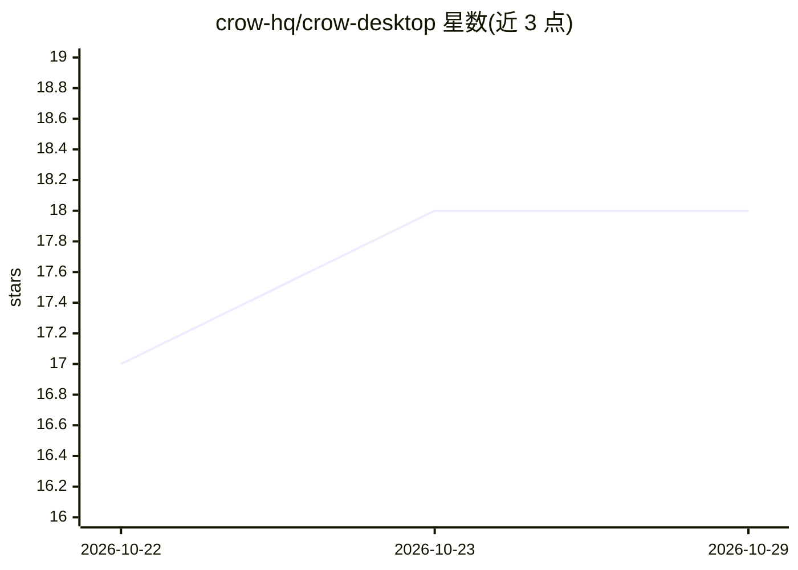

# crow-hq/crow-desktop

⭐ 18 · 推送 2026-10-28 · [GitHub](https://github.com/crow-hq/crow-desktop) · 组织维护

**桌面应用：把电脑里的文档整理成可对话的 Markdown 知识库**

面向不用终端的普通用户的免费跨平台桌面应用（macOS/Windows/Linux）。自动发现电脑中的 PDF、Word、幻灯片、表格等文档，通过 OpenRouter 上的 LLM 将每份文档摘要为按主题归档并互链的 Markdown 笔记，形成可持续更新的 wiki；回答问题并引用所依据的笔记。笔记以 Google Open Knowledge Format 存储，可在 Obsidian 中打开。需自备 OpenRouter 账户按用量付费，支持支出上限；无 OCR，扫描版 PDF 跳过。另可通过 MCP 接入 Claude、Claude Code、ChatGPT、Codex 作为其记忆。

## 筛选速览

| 维度 | 判定 | 备注 |
|---|---|---|
| AI 角色 | `ai-native` | 本体是模型或模型工具 |
| 许可风险 | `none` | — |
| 部署形态 | `desktop` | 安装包/桌面程序 |
| 模型依赖 | locked-api |  |
| 硬件要求 | — | 无带数字的原话,不猜 |
| 安装摩擦 | `low` | 无编译、无系统依赖或容器化 |
| 成熟度 | — | 结构信号不足 |

## 能力要点

- 自动发现本机文档并归档为互链 Markdown 笔记的 wiki
- 回答引用来源笔记，并在知识图谱中高亮显示
- 基于 llm-wiki-v2 的 CROW 架构，用分类器选文件夹而非向量数据库
- 通过 MCP 为 Claude/Claude Code/ChatGPT/Codex 提供 recall/read_note/remember 能力

## 适用场景

- 把电脑里堆积的文档整理成可查阅的知识库
- 以带引用的方式向自己的文档提问
- 让 Claude 或 ChatGPT 等应用查询并积累我的笔记

## 场景标签

`文档问答` `知识库管理` `Agent 记忆` · 领域:Agent 开发

## 证据(README 行号)

> L3:  Crow: an AI second brain built from the documents on your computer
> L15: **Crow is a free desktop app that turns the documents already on your computer into a second brain: a wiki of
> L30: - **Lets you chat with your documents, with sources.** Answers cite the notes they come from, and those notes light

## 星数曲线

2026-10-22 17 → 2026-10-29 18（+1）

---
*卡片 v1 · prompt 1.4 · 生成 2026-10-29 · 置信度 high · 依据 README sha `e75f926fe1a5` · [字段定义](../../DATASET.md)*
