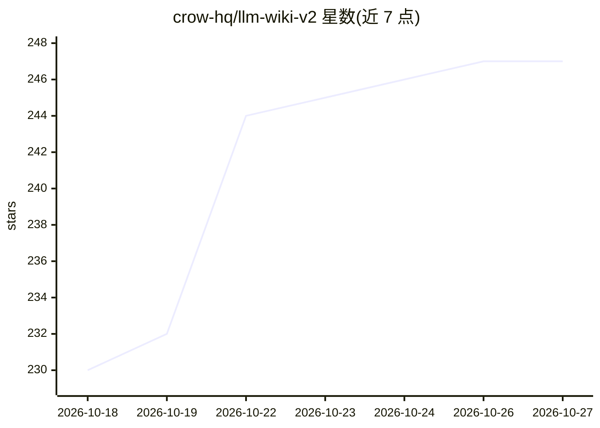

# crow-hq/llm-wiki-v2

⭐ 247 · Python · AGPL-3.0 · 推送 2026-10-26 · [GitHub](https://github.com/crow-hq/llm-wiki-v2) · [官网](https://pypi.org/project/llmwiki2/) · 组织维护

**把文档整理成带引用回答的本地 Markdown 百科（LLM Wiki v2）**

用户投放文本、PDF、Office、OpenDocument 文件后，系统将其整理为存放在 ~/llm-wiki 的纯 Markdown 笔记，按文件夹归档并互相关联；提问时给出答案并引用所用的笔记。支持 OpenRouter、OpenAI、Gemini、Ollama 及任意 OpenAI 兼容服务器，LLM 可完全本地运行。默认 CROW 模式由一个小分类器负责归档与检索路由，LLM 负责写作；无分类器时退回 classic 模式。提供 pip 库、CLI、Web UI、HTTP API、Docker 部署及桌面应用安装包。旧版二进制格式（.doc/.xls/.ppt）不读取，扫描版 PDF 需先 OCR。

## 筛选速览

| 维度 | 判定 | 备注 |
|---|---|---|
| AI 角色 | `ai-native` | 本体是模型或模型工具 |
| 许可风险 | `dual` | AGPL-3.0 |
| 部署形态 | `self-host` | docker 或自建部署 |
| 模型依赖 | local-ok | 支持本地模型 |
| 硬件要求 | — | 无带数字的原话,不猜 |
| 安装摩擦 | `low` | 无编译、无系统依赖或容器化 |
| 成熟度 | — | 结构信号不足 |

## 能力要点

- 文档自动归档为纯 Markdown 笔记，答案附带可点击的笔记引用
- CROW 模式用分类器做归档/检索路由，LLM 仅负责写作，可退回 classic 模式
- 支持 OpenRouter/OpenAI/Gemini/Ollama 及任意 OpenAI 兼容服务器，可全本地运行
- 提供 Python 库、CLI、Web UI、HTTP API 与 Docker 部署

## 适用场景

- 把个人文档整理成可阅读、可编辑、可用 git 管理的笔记库
- 对着自己的资料提问并获得带引用的答案
- 配合 Ollama 在本地完全私有地运行问答知识库

## 场景标签

`知识库管理` `文档问答` · 领域:知识与检索

## 证据(README 行号)

> L9: Give it your documents. It files them into a tidy wiki of Markdown notes and
> L10: answers your questions, citing the notes it used. It runs on your computer,
> L59: |**Ask questions**|Type a question. The answer cites the notes it used: click one to read it.|

## 星数曲线

2026-10-18 230 → 2026-10-27 247（+17）

---
*卡片 v1 · prompt 1.4 · 生成 2026-10-22 · 置信度 high · 依据 README sha `644da5a7b1e4` · [字段定义](../../DATASET.md)*
