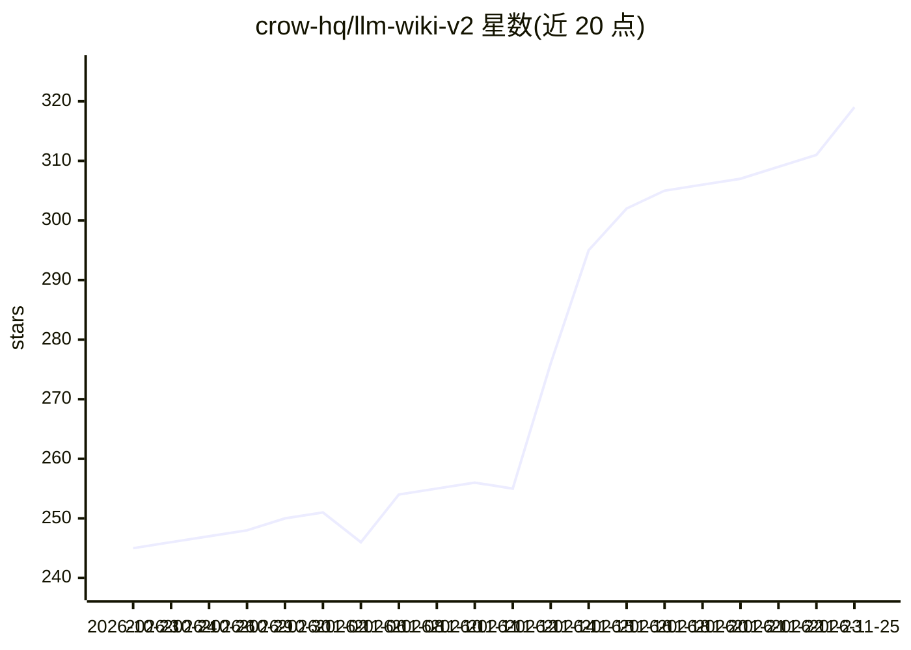

# crow-hq/llm-wiki-v2

⭐ 319 · Python · AGPL-3.0 · 推送 2026-11-17 · [GitHub](https://github.com/crow-hq/llm-wiki-v2) · [官网](https://pypi.org/project/llmwiki2/) · 组织维护

**把个人文档归档为可读 Markdown wiki 并带引用作答的本地工具**

llmwiki2 以 Python 库、网页界面与命令行形式提供：读入文本、Markdown、PDF、Office 等文档，自动分类归档为文件夹组织的 Markdown 笔记并建立链接，回答问题时引用所用笔记。默认 CROW 模式由小型分类器决定归档与检索路径，以控制增长时的成本与规模；无分类器时回退 classic 模式。支持作为 MCP 服务器为 Claude Code、Codex 等客户端提供长期记忆，提供 recall/remember/search 等工具。数据存于 ~/llm-wiki 的纯 Markdown，可纳入 git。附基准脚本与论文，基准为作者自测并在限制中声明。

## 筛选速览

| 维度 | 判定 | 备注 |
|---|---|---|
| AI 角色 | `ai-native` | 本体是模型或模型工具 |
| 许可风险 | `viral` | AGPL-3.0 |
| 部署形态 | `desktop` | 安装包/桌面程序 |
| 模型依赖 | local-ok | 支持本地模型 |
| 硬件要求 | — | 无带数字的原话,不猜 |
| 安装摩擦 | `low` | 无编译、无系统依赖或容器化 |
| 成熟度 | — | 结构信号不足 |

## 能力要点

- 文档自动归档为可读 Markdown 笔记，答案带引用并可点击打开来源笔记
- CROW 模式：小型分类器决定归档与检索，wiki 增长时 tokens 与成本增幅受限
- 可作为 MCP 服务器为 Claude Code/Codex 提供长期记忆（recall/remember/search 等工具）
- 支持 OpenRouter、OpenAI、Gemini、Ollama 或任意 OpenAI 兼容服务器

## 适用场景

- 把散落的 PDF、邮件、手册整理成可浏览、可 git 管理的个人 wiki
- 让 Claude Code 记住并引用我自己的文档来回答问题
- 本地离线运行：用 Ollama 免 key 处理私密文档
- 文档数量增长后仍想保持检索准确与成本可控

## 场景标签

`知识库管理` `文档问答` `RAG` `Agent 记忆` · 领域:Agent 开发

## 证据(README 行号)

> L9: Give it your documents. It files them into a tidy wiki of Markdown notes and
> L12: any OpenAI-compatible server. It works in **CROW** mode by default: a small
> L69: The wiki can be the long-term memory of Claude Code, Codex or any MCP client, documents already filed included.

## 星数曲线

2026-10-23 245 → 2026-11-25 319（+74）

---
*卡片 v1 · prompt 1.4 · 生成 2026-11-25 · 置信度 mid · 依据 README sha `ec8ecf60c94b` · [字段定义](../../DATASET.md)*
