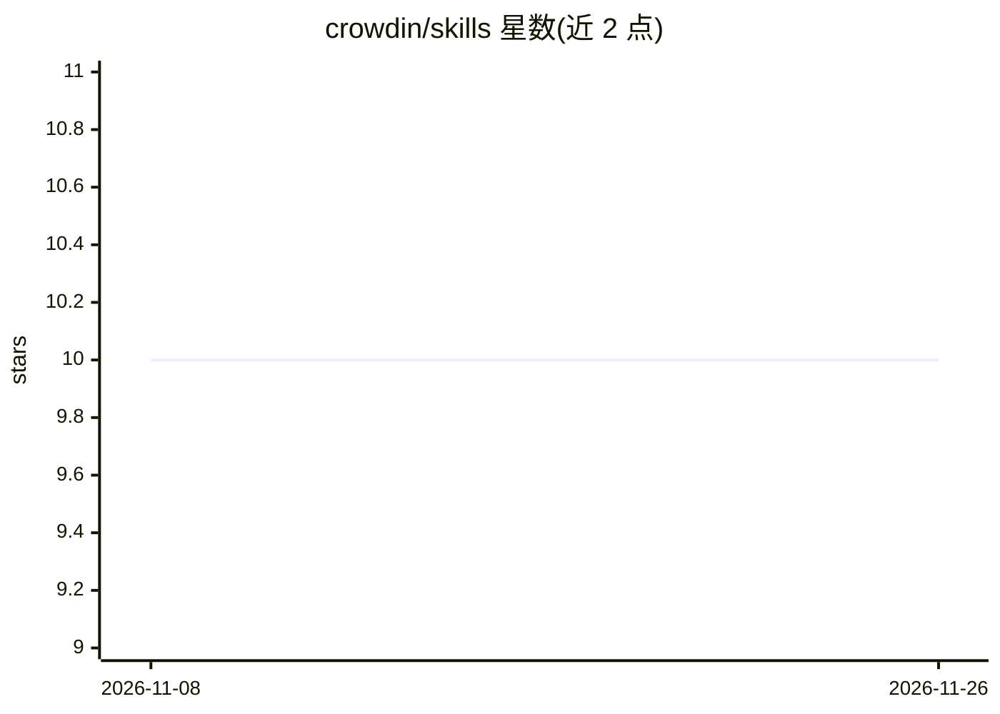

# crowdin/skills

⭐ 10 · Shell · MIT · 推送 2026-11-25 · [GitHub](https://github.com/crowdin/skills) · 组织维护

**为 AI 编码 agent 提供 Crowdin 本地化知识的技能集**

面向 Crowdin（AI 驱动的本地化平台）的 Agent Skills 合集：以 SKILL.md 形式提供流程性知识与最佳实践，一条 npx 命令或各 agent 工具的插件渠道安装。技能覆盖 Crowdin CLI 配置与同步、GitHub Action、集成应用同步、ai_context 填写、术语表构建与翻译、翻译草稿、截图生成、API 客户端、CroQL 与 GraphQL 查询编写。附带 Crowdin MCP Server 供 agent 直接访问 Crowdin 项目，支持 Claude Code 插件、Codex、Gemini CLI、GitHub CLI 等多种安装途径。

## 筛选速览

| 维度 | 判定 | 备注 |
|---|---|---|
| AI 角色 | `ai-knowledge` | 知识聚合/清单类 |
| 许可风险 | `permissive` | MIT |
| 部署形态 | `library` | 以包/库形式分发 |
| 模型依赖 | — | README 未给出锁定关系 |
| 硬件要求 | — | 无带数字的原话,不猜 |
| 安装摩擦 | `low` | 无编译、无系统依赖或容器化 |
| 成熟度 | — | 结构信号不足 |

## 能力要点

- 一套命令安装全部 Crowdin 技能（npx skills add）
- 捆绑 Crowdin MCP Server，经浏览器 OAuth 认证访问项目
- 支持 Claude Code 插件、Codex、Gemini CLI、GitHub CLI、plugins CLI 等多种安装渠道
- 12+ 技能覆盖 CLI、GitHub Action、API 客户端、术语表、翻译、截图等流程

## 适用场景

- 让 AI agent 正确配置 crowdin.yml 与 CLI 同步本地化文件
- 搭建和调试 crowdin/github-action 的翻译 PR 流程
- 从项目内容构建术语表并补全术语翻译
- 为缺少截图的字符串捕获并上传界面截图

## 场景标签

`提示工程` · 领域:Agent 开发

## 证据(README 行号)

> L5: This repository contains Agent Skills for Crowdin, an AI-powered localization platform for teams and businesses.
> L9: Skills are reusable capabilities for AI coding agents. They provide procedural knowledge and best practices that hel

## 星数曲线

2026-11-08 10 → 2026-11-26 10（+0）

---
*卡片 v1 · prompt 1.4 · 生成 2026-11-19 · 置信度 high · 依据 README sha `761c4fd73061` · [字段定义](../../DATASET.md)*
