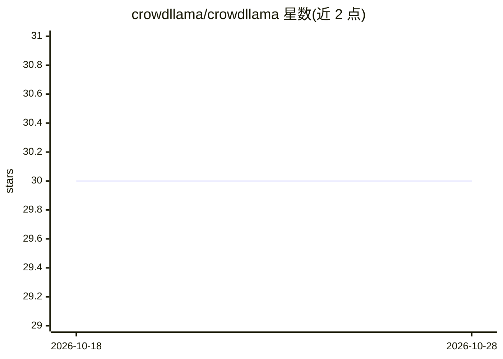

# crowdllama/crowdllama

⭐ 31 · Go · MIT · 推送 2025-11-27 · [GitHub](https://github.com/crowdllama/crowdllama) · [官网](https://crowdllama.ai/) · 组织维护

**基于 Ollama 的 P2P 多节点分布式 LLM 推理系统**

Go 编写的分布式系统，利用开源 Ollama 项目在多个节点间通过 P2P 网络运行 LLM 推理任务。包含三个组件：基于 DHT 的节点发现服务器、在 DHT 上注册并广播 GPU 资源与所支持模型的 Worker，以及尚在计划中的 Consumer（用于发现并调度可用 worker 执行分布式任务）。通过 git clone 源码并用 go build 编译 DHT 服务器与 Worker，MIT 许可证。

## 筛选速览

| 维度 | 判定 | 备注 |
|---|---|---|
| AI 角色 | `ai-ecosystem` | LLM/agent 周边工具 |
| 许可风险 | `permissive` | MIT |
| 部署形态 | `None` |  |
| 模型依赖 | local-ok | 支持本地模型 |
| 硬件要求 | — | 无带数字的原话,不猜 |
| 安装摩擦 | `low` | 无编译、无系统依赖或容器化 |
| 成熟度 | — | 结构信号不足 |

## 能力要点

- 基于 DHT 的 P2P 节点发现机制
- Worker 节点广播自身 GPU 能力与支持的模型
- 简单元数据协议查询节点信息
- Consumer 组件规划中，将调度分布式任务

## 适用场景

- 把多台机器的 GPU 组成 P2P 集群协同跑 LLM 推理
- 在节点间发现并查询可用 GPU 资源与模型
- 研究去中心化的 LLM 推理负载分配

## 场景标签

`推理引擎` · 领域:训练与推理

## 证据(README 行号)

> L7: CrowdLlama is a distributed system that leverages the open-source Ollama project to run LLM inference tasks across m
> L16: - **Worker**: Registers itself on the DHT and advertises its GPU resources and supported models.

## 星数曲线

2026-10-18 30 → 2026-10-28 30（+0）

---
*卡片 v1 · prompt 1.4 · 生成 2026-10-26 · 置信度 high · 依据 README sha `659079e470d6` · [字段定义](../../DATASET.md)*
