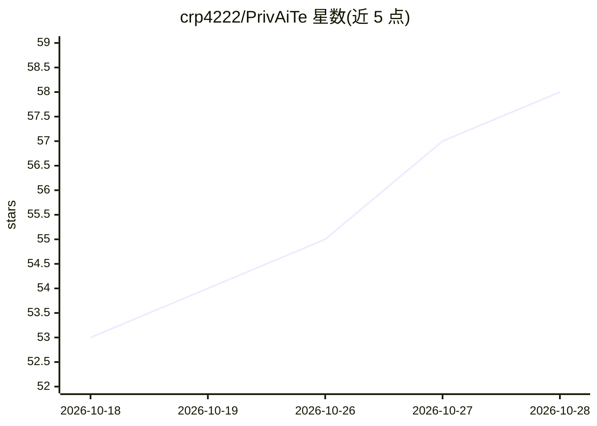

# crp4222/PrivAiTe

⭐ 58 · Python · BSD-3-Clause · 推送 2026-10-23 · [GitHub](https://github.com/crp4222/PrivAiTe) · [官网](https://crp4222.github.io/PrivAiTe/) · 个人维护

**自托管 PII 脱敏代理：在请求离开本机前清洗 LLM 流量并在回复中还原**

面向 LLM API 与 agent CLI（Claude Code、Codex 等 OpenAI 兼容客户端）的本地代理：请求发出前检测并替换姓名、邮箱、卡号与密钥等敏感值（含工具调用参数与多模态文本），回复返回时将占位符还原为真实值（支持流式）；密钥与卡号可按类型设为永久脱敏。检测（Presidio + OpenAI 开源 privacy-filter 模型）全部本地运行，无遥测，检测失败则阻断请求（fail closed）。提供 Docker 镜像与 pip 安装，附 Open WebUI 过滤器与 LiteLLM guardrail 集成。README 明确威胁模型：检测为统计性尽力而为，不覆盖漏检、再识别与被入侵的本地机器；定位是假名化而非匿名化。

## 筛选速览

| 维度 | 判定 | 备注 |
|---|---|---|
| AI 角色 | `ai-ecosystem` | LLM/agent 周边工具 |
| 许可风险 | `permissive` | BSD-3-Clause |
| 部署形态 | `self-host` | docker 或自建部署 |
| 模型依赖 | — | README 未给出锁定关系 |
| 硬件要求 | — | 无带数字的原话,不猜 |
| 安装摩擦 | `low` | 无编译、无系统依赖或容器化 |
| 成熟度 | — | 结构信号不足 |

## 能力要点

- 清洗包括工具调用参数、工具结果与多模态文本在内的请求内容
- 回复流式还原占位符，密钥/卡号可按类型设为永久脱敏
- 本地检测（Presidio + privacy-filter 模型），零遥测，检测失败 fail closed
- Gateway 模式适配 Claude Code / Codex 原生协议并透传其自身认证

## 适用场景

- 让 Claude Code / Codex 等 agent CLI 的外发流量先经过脱敏
- 任何 OpenAI 兼容客户端接入本地代理以避免 PII 与密钥到达提供商
- GDPR/HIPAA 场景下作为假名化与传输最小化手段

## 场景标签

`模型网关` `网络安全` · 领域:Agent 开发

## 证据(README 行号)

> L3: **Your coding agent reads your `.env` files, logs and command output, and everything it reads goes to the LLM provid
> L57: Gateway mode (opt-in, off by default) speaks the native protocols of agent CLIs. It scrubs each request, tool resul
> L76: - **It fails closed and stays local.** If detection errors, the request is blocked, not forwarded. Detection (Presi

## 星数曲线

2026-10-18 53 → 2026-10-28 58（+5）

---
*卡片 v1 · prompt 1.4 · 生成 2026-10-24 · 置信度 high · 依据 README sha `c187e972deb1` · [字段定义](../../DATASET.md)*
