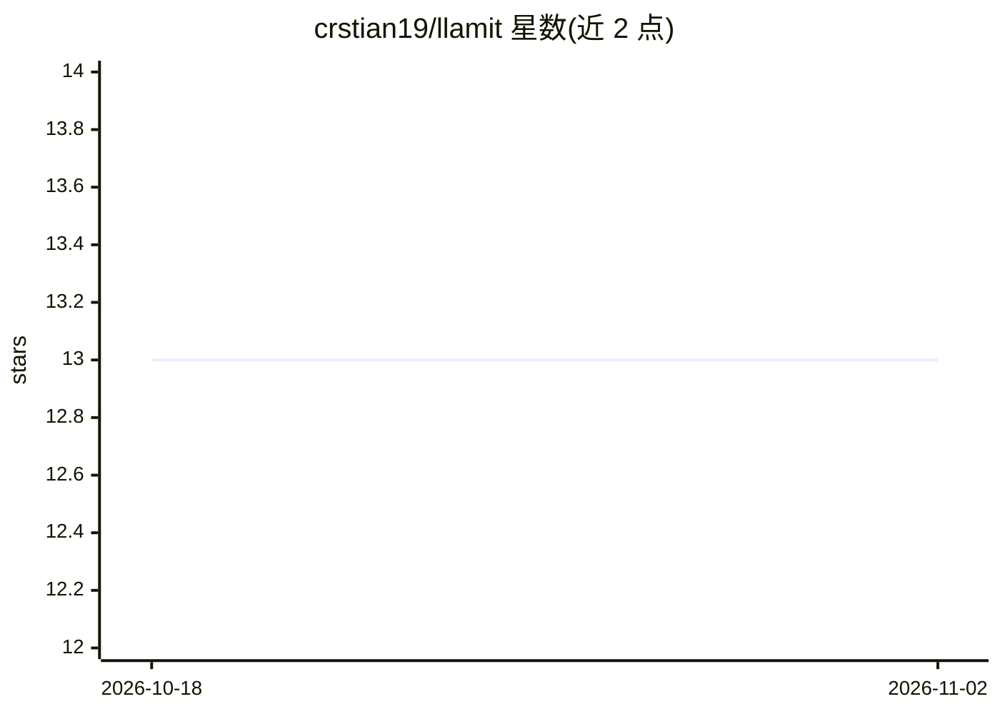

# crstian19/llamit

⭐ 13 · TypeScript · MIT · 推送 2026-10-28 · [GitHub](https://github.com/crstian19/llamit) · [官网](https://llamit.crstian.me) · 个人维护

**VS Code 扩展：用本地 Ollama 等端点生成语义化提交信息**

Llamit 是一个 VS Code 扩展，用于生成语义化 Git 提交信息。架构为 VS Code 扩展加 Go CLI 后端：CLI 读取 Git diff，按所选提交格式构建提示词，调用本地 Ollama 或任意 OpenAI 兼容的 /v1/chat/completions 端点，将生成的提交信息写入源代码管理输入框。支持 Conventional、Angular、Gitmoji、Karma、Semantic、Google 及自定义格式，带重试逻辑。2.0.0 起不再仅限 Ollama，可配置自定义 URL 与 API key。要求 VS Code 1.85.0+。

## 筛选速览

| 维度 | 判定 | 备注 |
|---|---|---|
| AI 角色 | `ai-native` | 本体是模型或模型工具 |
| 许可风险 | `permissive` | MIT |
| 部署形态 | `None` |  |
| 模型依赖 | local-ok | 支持本地模型 |
| 硬件要求 | — | 无带数字的原话,不猜 |
| 安装摩擦 | `low` | 无编译、无系统依赖或容器化 |
| 成熟度 | — | 结构信号不足 |

## 能力要点

- 支持 Ollama 与 OpenAI 兼容端点，可配置自定义 URL
- 7 种内置提交格式加自定义模板
- Go CLI 后端，读取 stdin diff、stdout 输出提交信息，含重试逻辑
- 优先使用暂存区改动，回退到工作区改动

## 适用场景

- 在 VS Code 中从源代码管理面板一键生成提交信息
- 用本地 Ollama 模型生成提交信息，不依赖云端 API
- 按团队规范（Conventional/Angular/Gitmoji 等）统一提交格式

## 场景标签

`AI 写作` · 领域:内容生成

## 证据(README 行号)

> L13: **Generate semantic commit messages using Ollama or any OpenAI-compatible endpoint.**
> L148: - reads Git diff from `stdin`

## 星数曲线

2026-10-18 13 → 2026-11-02 13（+0）

---
*卡片 v1 · prompt 1.4 · 生成 2026-10-31 · 置信度 high · 依据 README sha `98e009e805c6` · [字段定义](../../DATASET.md)*
