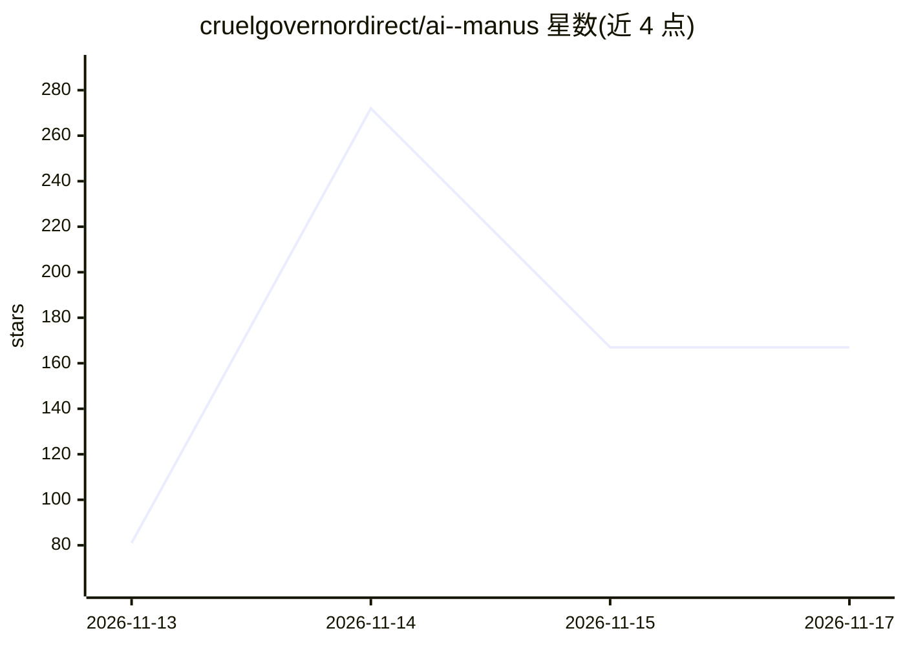

# cruelgovernordirect/ai--manus

⭐ 167 · Apache-2.0 · 推送 2026-11-15 · [GitHub](https://github.com/cruelgovernordirect/ai--manus) · 个人维护

**面向个人用户的自主 AI Agent：代跑代码与操控浏览器**

Manus 定位为自主 AI Agent，可代用户编写并执行脚本、操控浏览器完成导航网页、填写表单、信息收集等多步骤任务，并以个人助手形式在后台待命，面向学习、家庭与轻量办公等小规模场景。README 说明其兼容性要求（4 GB 内存起步、64 位系统、标准用户权限，完整浏览器控制需提升权限）并给出配置-测试-调整的上手流程。仓库主题标签提及 OpenAI、Anthropic、Gemini、React 等，但 README 正文未给出具体模型接入方式、安装命令或代码结构，技术实现细节不可从 README 验证。

## 筛选速览

| 维度 | 判定 | 备注 |
|---|---|---|
| AI 角色 | `ai-native` | 本体是模型或模型工具 |
| 许可风险 | `permissive` | Apache-2.0 |
| 部署形态 | `None` |  |
| 模型依赖 | — | README 未给出锁定关系 |
| 硬件要求 | — | 无带数字的原话,不猜 |
| 安装摩擦 | `low` | 无编译、无系统依赖或容器化 |
| 成熟度 | — | 结构信号不足 |

## 能力要点

- 自主执行代码与浏览器操控相结合的多步骤任务
- 以个人助手形式后台待命、跨会话复用工作流模式
- 面向家庭、学习与轻量办公等小规模场景

## 适用场景

- 让 AI 代为完成网页查询、表单填写等重复操作
- 学生与研究场景中收集资料、运行小脚本
- 远程排障时整理诊断步骤并检查系统页面

## 场景标签

`AI 助手` `浏览器自动化` `编码 Agent` · 领域:效率与自动化

## 证据(README 行号)

> L10: - **Autonomous Code Execution:** Manus AI agent runs code on its own to complete tasks, so you can focus on decisio
> L18: Manus is an autonomous AI agent designed to run code and control a browser on your behalf. Instead of acting like a

## 星数曲线

2026-11-13 81 → 2026-11-17 167（+86）

---
*卡片 v1 · prompt 1.4 · 生成 2026-11-17 · 置信度 mid · 依据 README sha `67c3d4d92b69` · [字段定义](../../DATASET.md)*
