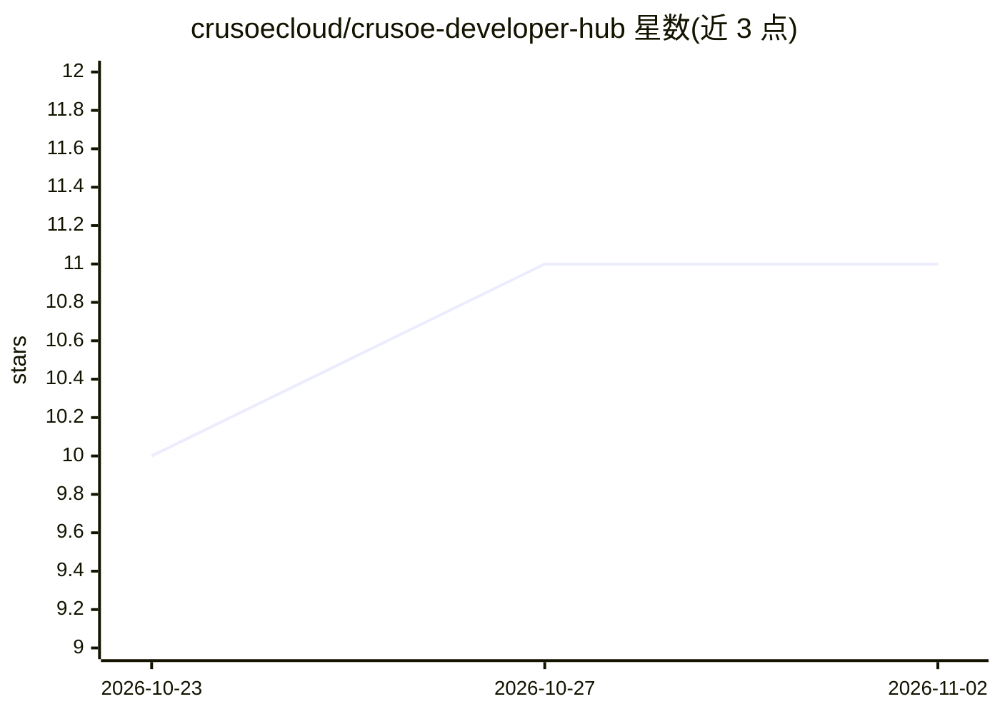

# crusoecloud/crusoe-developer-hub

⭐ 11 · Python · MIT · 推送 2026-10-30 · [GitHub](https://github.com/crusoecloud/crusoe-developer-hub) · [官网](https://discord.gg/tRKs5bMyry) · 组织维护

**Crusoe Cloud 开发者中心：AI 训练/微调/推理的教程与示例汇编**

Crusoe 公司维护的开发者内容仓库，面向在 Crusoe Cloud 上构建 AI 应用与基础设施的开发者。发布三类内容：基础课程（Triton GPU 内核、量化、LoRA/QLoRA 等）、端到端可运行示例（资源配置、数据准备与微调、模型服务）、以及与 LangChain、LiteLLM、MLflow、Cursor 等工具的集成。平台提供 OpenAI 兼容的托管推理 API 与 GPU 虚拟机；本仓库本身是文档与代码集合，非可安装产品，部分服务按用量计费。

## 筛选速览

| 维度 | 判定 | 备注 |
|---|---|---|
| AI 角色 | `ai-knowledge` | 知识聚合/清单类 |
| 许可风险 | `permissive` | MIT |
| 部署形态 | `library` | 以包/库形式分发 |
| 模型依赖 | — | README 未给出锁定关系 |
| 硬件要求 | — | 无带数字的原话,不猜 |
| 安装摩擦 | `low` | 无编译、无系统依赖或容器化 |
| 成熟度 | — | 结构信号不足 |

## 能力要点

- 四类内容目录：foundations/examples/integrations/solutions-library
- 覆盖 Serverless 推理（OpenAI 兼容 API）与 LoRA 微调示例
- 集成 LangChain、LiteLLM、MLflow、Google ADK、Cursor 等工具
- GPU 集群工作流：Kubernetes/Slurm、NCCL、KServe、Grafana

## 适用场景

- 学习 GPU 内核、量化、LoRA 微调等基础机制
- 在 Crusoe Cloud 上完成从资源配置到模型服务的端到端任务
- 将 Crusoe 推理接入已有的 LangChain/LiteLLM 等工具链

## 场景标签

`教程课程` · 领域:学习与行业

## 证据(README 行号)

> L15: The Crusoe Developer Hub is the technical home for developers building AI applications and infrastructure on Crusoe
> L205: The repository is organized by what you are trying to do, not by product. Four top-level directories hold the cont
> L207: - `foundations/` explains the mechanics: GPU kernels in Triton, quantization, LoRA and QLoRA, and, as the tracks g

## 星数曲线

2026-10-23 10 → 2026-11-02 11（+1）

---
*卡片 v1 · prompt 1.4 · 生成 2026-11-02 · 置信度 mid · 依据 README sha `fa722e717cc6` · [字段定义](../../DATASET.md)*
