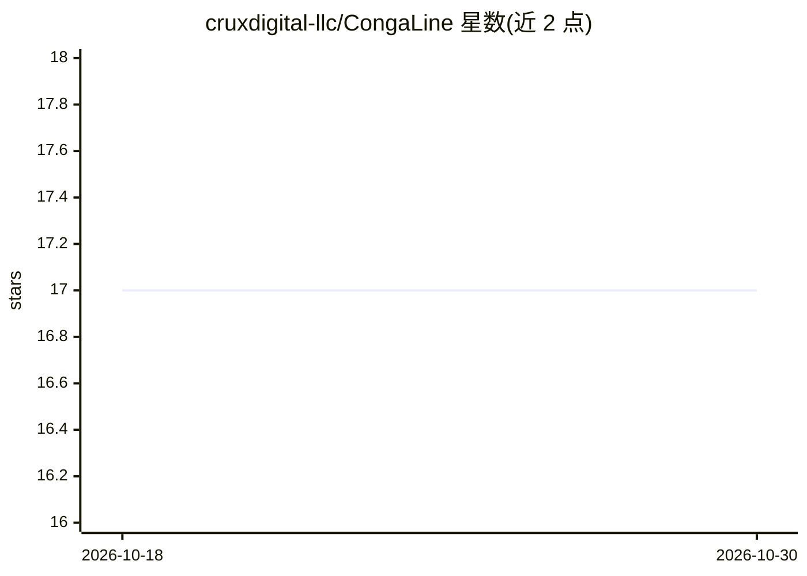

# cruxdigital-llc/CongaLine

⭐ 17 · Go · Apache-2.0 · 推送 2026-07-23 · [GitHub](https://github.com/cruxdigital-llc/CongaLine) · [官网](https://congaline.ai) · 组织维护

**自托管 AI agent 舰队部署管理工具：单 CLI 管理多容器隔离代理**

用单个 conga CLI 部署和管理一组相互隔离的 AI agent：每个 agent 拥有独立 Docker 容器、网络、密钥与身份。运行时可插拔（OpenClaw 或 Hermes Agent），渠道支持 Slack 与 Telegram（各有专用路由容器扇出事件），也可仅通过 web UI 网关使用。部署目标提供 local Docker、SSH 远程主机（VPS/树莓派）与 AWS（Terraform 零入向）三类 provider，egress 规则与模型路由由统一 conga-policy.yaml 定义。限制：多运行时目前在 local provider 完整可用，remote/AWS 默认 OpenClaw；Terraform 全生命周期管理在路线图中。

## 筛选速览

| 维度 | 判定 | 备注 |
|---|---|---|
| AI 角色 | `ai-ecosystem` | LLM/agent 周边工具 |
| 许可风险 | `permissive` | Apache-2.0 |
| 部署形态 | `self-host` | docker 或自建部署 |
| 模型依赖 | locked-api |  |
| 硬件要求 | — | 无带数字的原话,不猜 |
| 安装摩擦 | `low` | 无编译、无系统依赖或容器化 |
| 成熟度 | `idea` | |

## 能力要点

- 每个 agent 独立容器/网络/密钥/配置的隔离架构
- 可插拔运行时（OpenClaw/Hermes），新增运行时只需实现 22 方法接口
- local/remote/AWS 三类部署 provider，单 conga-policy.yaml 定义 egress 与模型路由
- Slack/Telegram 路由容器隔离，单渠道崩溃不影响其他渠道

## 适用场景

- 在自有 VPS 或本地 Docker 上自托管多个 AI assistant 并接入 Slack/Telegram
- 团队以 channel 绑定方式共享 agent，个人用 DM-only agent
- 在 AWS 上以零入向方式部署生产级 agent 舰队并用 Terraform 管理基础设施

## 场景标签

 · 领域:AI agent 基础设施/部署运维

## 证据(README 行号)

> L8: Self-host a fleet of isolated AI agents — each with its own container, network, secrets, and identity — managed thro
> L13: - **Pluggable agent runtimes** — choose OpenClaw or Hermes per agent. Same Conga infrastructure, your choice of age
> L32: **Provider** decides *where* an agent runs (AWS, local Docker, remote SSH host).

## 星数曲线

2026-10-18 17 → 2026-10-30 17（+0）

---
*卡片 v1 · prompt 1.4 · 生成 2026-10-30 · 置信度 mid · 依据 README sha `324abb11c174` · [字段定义](../../DATASET.md)*
