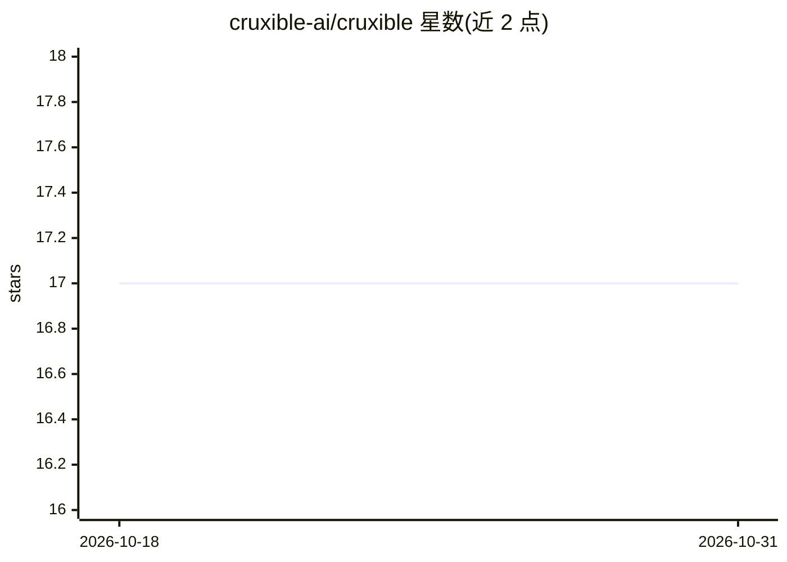

# cruxible-ai/cruxible

⭐ 17 · Python · Apache-2.0 · 推送 2026-10-30 · [GitHub](https://github.com/cruxible-ai/cruxible) · 组织维护

**给 AI agent 的受治理状态引擎：类型化知识工件全生命周期管理**

面向运行多 agent 的组织与开发者：Cruxible 产出称为 Crux 的可执行领域知识工件，将 agent 产生的判断、观察与行为方式以类型化声明与过程的形式纳入提议—证据—评审—生效的代码化生命周期。机制包括：YAML 声明本体与规则、写入卡点强制执行策略、结果契约与门禁、快照与回执；MCP server、CLI 与 Python 客户端接入同一守护进程，底层为 SQLite 单文件。引擎内不运行 LLM，demo 无需模型调用与 API key。

## 筛选速览

| 维度 | 判定 | 备注 |
|---|---|---|
| AI 角色 | `ai-ecosystem` | LLM/agent 周边工具 |
| 许可风险 | `permissive` | Apache-2.0 |
| 部署形态 | `library` | 以包/库形式分发 |
| 模型依赖 | — | README 未给出锁定关系 |
| 硬件要求 | — | 无带数字的原话,不猜 |
| 安装摩擦 | `low` | 无编译、无系统依赖或容器化 |
| 成熟度 | — | 结构信号不足 |

## 能力要点

- 声明—评审—生效的类型化声明与过程生命周期，写入卡点拒绝非法变更
- MCP server / CLI / Python 客户端接入同一守护进程，agent 接入仅需一个 MCP 配置块
- 结果契约在决策生效前声明成功标准并记录实际结果
- 可组合的 Kit 模板（agent-operation / project-domain / agent-release）

## 适用场景

- 多 agent 组织共享同一份受治理的实时声明与规则
- 要求 agent 的判断附带证据并经评审后方可生效
- 对 agent 学到的可复用动作施加前置条件与执行预算约束

## 场景标签

`多智能体` `Agent 记忆` · 领域:Agent 开发

## 证据(README 行号)

> L19: **Cruxible is a governed state engine for AI agents.** It produces a **Crux**:
> L169: - MCP server, CLI, and Python client against the
> L206: Cruxible never asks a model to follow the rules, because the rules run as

## 星数曲线

2026-10-18 17 → 2026-10-31 17（+0）

---
*卡片 v1 · prompt 1.4 · 生成 2026-10-29 · 置信度 high · 依据 README sha `204904a35d2a` · [字段定义](../../DATASET.md)*
