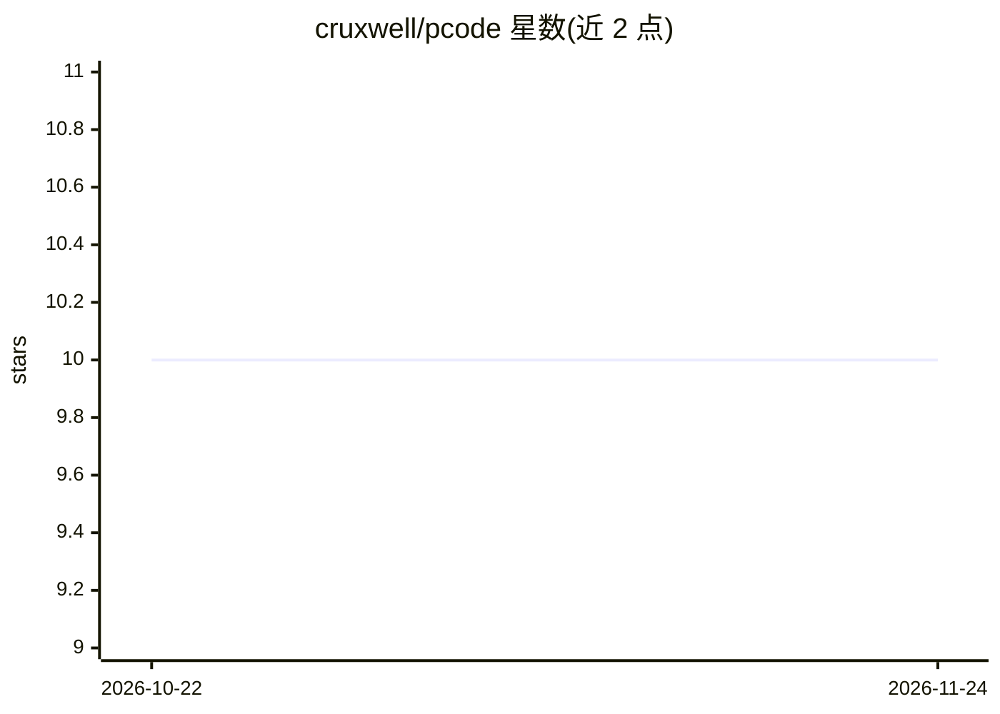

# cruxwell/pcode

⭐ — · [GitHub]() · 个人维护

**终端原生 AI 编码代理：后台任务、并行 worktree、可分叉会话**

pcode 是运行在终端中的编码代理，用户通过对话驱动其编辑文件与执行 shell 命令（以当前用户权限运行、无审批提示）。关键机制包括：长命令转为后台作业并在完成后唤醒代理以跟进测试/CI、每个会话独立 git worktree 支持多代理并行操作同一仓库、/tree 回溯并分叉对话、可折叠的 scrollback 视图与 /tools 工具调用检查。基于 Pydantic AI Harness 构建，支持 MCP（OAuth 与工具搜索）、邮件远程控制、Vim 键位与 Python 扩展。README 提示使用前应先阅读工具权限文档。

## 筛选速览

| 维度 | 判定 | 备注 |
|---|---|---|
| AI 角色 | `ai-native` | 本体是模型或模型工具 |
| 许可风险 | `permissive` | — |
| 部署形态 | `library` | 以包/库形式分发 |
| 模型依赖 | locked-api |  |
| 硬件要求 | — | 无带数字的原话,不猜 |
| 安装摩擦 | `low` | 无编译、无系统依赖或容器化 |
| 成熟度 | — | 结构信号不足 |

## 能力要点

- 后台作业机制：长命令完成后唤醒代理跟进测试或 CI
- 每会话独立 git worktree，多代理并行操作同一仓库
- /tree 回溯与分叉对话，会话全量保留可恢复与检索
- 基于 Pydantic AI Harness，支持 MCP（OAuth、工具搜索）与 Python 扩展

## 适用场景

- 让代理在后台盯 CI/测试并在失败时继续修复
- 多个代理并行在同一仓库的不同 worktree 上工作
- 回溯对话分叉尝试不同实现方案
- 从手机 Gmail 发送任务并在终端接管会话

## 场景标签

`编码 Agent` · 领域:编码与开发

## 证据(README 行号)

> L7: pcode is a terminal-native coding agent that lets you change what's visible in
> L26: It runs on any model Pydantic AI supports, or on
> L59: **The agent edits files and runs shell commands with your permissions and no

## 星数曲线

2026-10-22 10 → 2026-11-24 10（+0）

---
*卡片 v1 · prompt 1.4 · 生成 2026-11-19 · 置信度 high · 依据 README sha `17c66e466fa6` · [字段定义](../../DATASET.md)*
