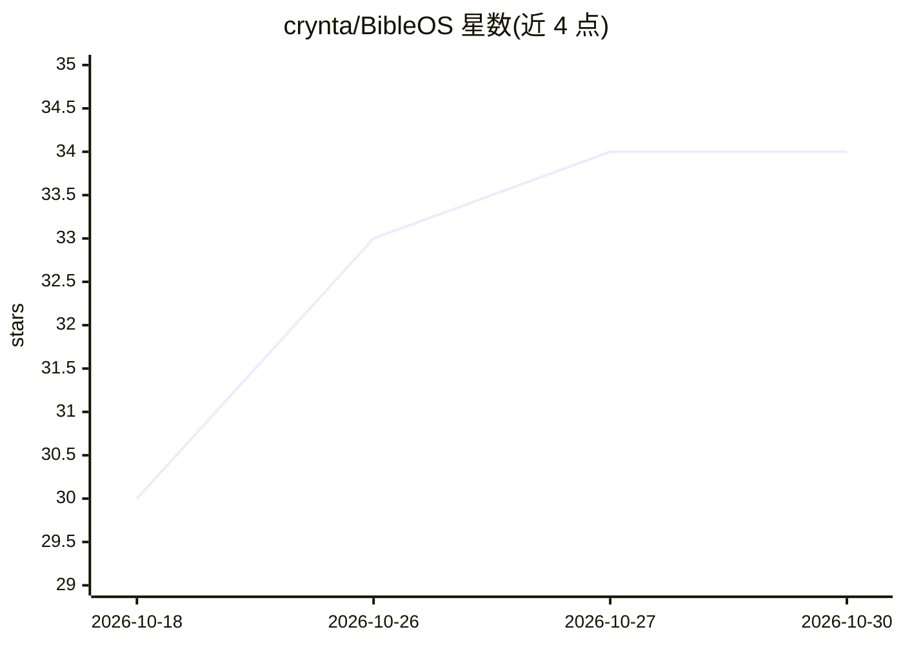

# crynta/BibleOS

⭐ 34 · TypeScript · MIT · 推送 2026-04-14 · [GitHub](https://github.com/crynta/BibleOS) · 个人维护

**带 AI 经文对话的跨平台轻量圣经阅读器**

基于 Tauri 2.0 + React + Rust 的开源桌面圣经阅读应用，面向个人灵修与研经用户：提供全书阅读、经文快速搜索、深浅色模式与 Discover 相关内容浏览，本地 SQLite 存储、约 10-20MB 体积、数据不上传。AI 聊天功能采用 BYOK 模式，需用户自行配置 OpenAI API key，用于讨论经文语境与生成灵修内容。需从源码构建运行，目前仅内置默认圣经数据，多译本、笔记、高亮等为规划功能。

## 筛选速览

| 维度 | 判定 | 备注 |
|---|---|---|
| AI 角色 | `ai-enhanced` | 去掉 AI 部分产品仍成立 |
| 许可风险 | `permissive` | MIT |
| 部署形态 | `library` | 以包/库形式分发 |
| 模型依赖 | — | README 未给出锁定关系 |
| 硬件要求 | — | 无带数字的原话,不猜 |
| 安装摩擦 | `low` | 无编译、无系统依赖或容器化 |
| 成熟度 | — | 结构信号不足 |

## 能力要点

- 圣经全书阅读与跨书章经文快速搜索
- BYOK AI 聊天：讨论经文语境、提问，需自配 OpenAI API key
- 本地 SQLite 存储、离线优先、约 10-20MB 轻量体积
- Discover 功能基于当前阅读推荐注释与相关内容

## 适用场景

- 日常阅读与检索圣经经文
- 边读经边向 AI 提问探讨经文背景与含义
- 注重隐私的本地化灵修学习

## 场景标签

`聊天机器人` · 领域:对话与助手

## 证据(README 行号)

> L13: **Bible OS** is an open-source Bible reader application designed for Bible study and spiritual growth. Built with m
> L21: - [x] AI Chat Integration - Discuss scripture context, ask questions, and explore deeper meanings
> L24: - [x] Privacy-First - Local. Your data stays on your machine, AI is BYOK

## 星数曲线

2026-10-18 30 → 2026-10-30 34（+4）

---
*卡片 v1 · prompt 1.4 · 生成 2026-10-26 · 置信度 mid · 依据 README sha `1860e7435cc4` · [字段定义](../../DATASET.md)*
