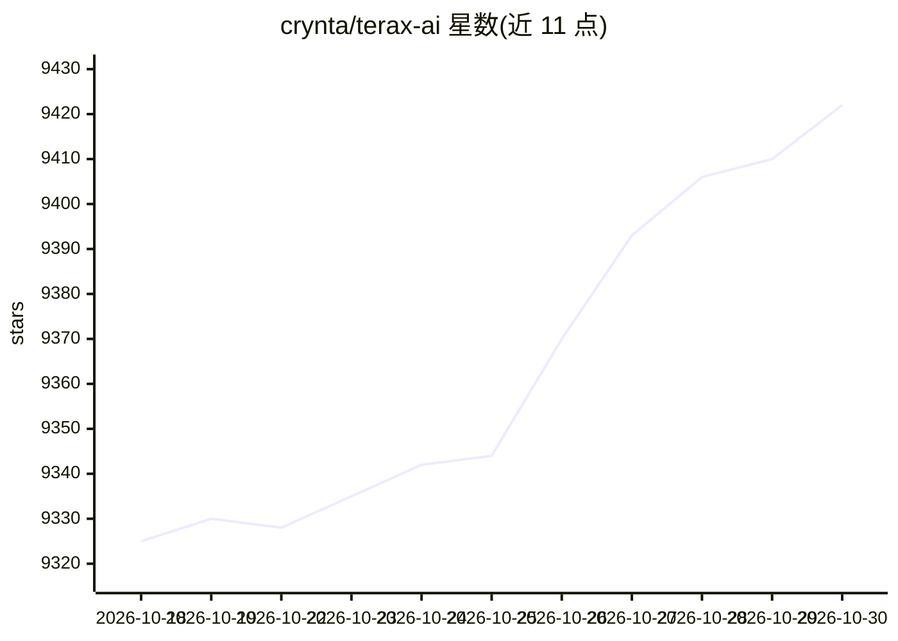

# crynta/terax-ai

⭐ 9,422 · TypeScript · Apache-2.0 · 推送 2026-10-29 · [GitHub](https://github.com/crynta/terax-ai) · [官网](https://terax.app) · 组织维护 · 中文 README

**轻量终端优先的 AI 原生开发环境（约 7-8MB）**

基于 Tauri 2 + Rust + React 19 的桌面开发工作区：原生 PTY 后端的 WebGL 终端（多标签、分屏、WSL 工作区）、CodeMirror 6 代码编辑器、带提交图的源代码管理、文件浏览器与本地 dev server 的 Web 预览。AI 部分为侧边栏 Agent：支持 BYOK（OpenAI/Anthropic/Gemini 等）与本地推理（Ollama/LM Studio/MLX），可编排 Claude Code，API key 存入 OS 钥匙串。v0.9.0 正在从 xterm.js 迁移到 libghostty + WebGPU。安装包约 7-8MB，无遥测、无账号。

## 筛选速览

| 维度 | 判定 | 备注 |
|---|---|---|
| AI 角色 | `ai-enhanced` | 去掉 AI 部分产品仍成立 |
| 许可风险 | `permissive` | Apache-2.0 |
| 部署形态 | `desktop` | 安装包/桌面程序 |
| 模型依赖 | local-ok | 支持本地模型 |
| 硬件要求 | — | 无带数字的原话,不猜 |
| 安装摩擦 | `low` | 无编译、无系统依赖或容器化 |
| 成熟度 | — | 结构信号不足 |

## 能力要点

- 原生 PTY 终端 + WebGL 渲染，约 7-8MB 磁盘占用
- BYOK 多提供商与 Ollama/LM Studio/MLX 本地模型支持
- Agent 工作流：计划、子代理、文件工具、审批门控 bash、项目记忆 TERAX.md
- API key 写入 OS 钥匙串，不落盘

## 适用场景

- 在一个轻量桌面应用里完成终端、编辑、Git 与预览的开发流程
- 用自己的 API key 或本地模型驱动 AI 编码助手
- 在 Windows 上以 WSL 发行版作为工作区环境

## 场景标签

`编码 Agent` · 领域:编码与开发

## 证据(README 行号)

> L30: Terax is a lightweight open-source terminal-first AI-native development environment (ADE) built on Tauri 2 + Rust a
> L100: - **BYOK providers:** OpenAI, Anthropic, Google (Gemini), Groq, xAI (Grok), Cerebras, OpenRouter, DeepSeek, Mistra
> L101: - **Local / offline:** LM Studio, MLX, Ollama

## 星数曲线

2026-10-18 9,325 → 2026-10-30 9,422（+97）

---
*卡片 v1 · prompt 1.4 · 生成 2026-10-20 · 置信度 mid · 依据 README sha `a9fe56793e71` · [字段定义](../../DATASET.md)*
