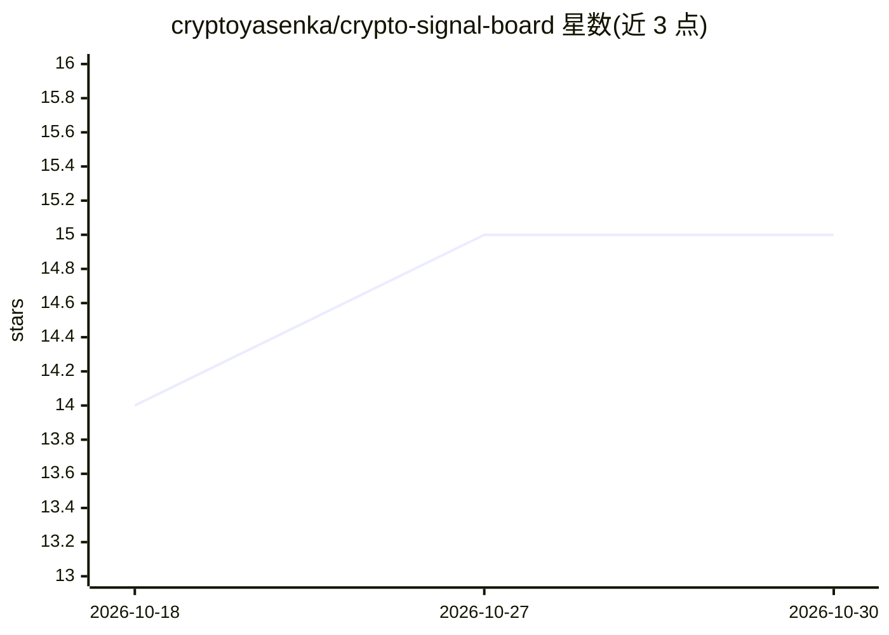

# cryptoyasenka/crypto-signal-board

⭐ 15 · TypeScript · MIT · 推送 2026-08-13 · [GitHub](https://github.com/cryptoyasenka/crypto-signal-board) · [官网](https://crypto-signal-board.vercel.app) · 个人维护

**在 TEE 中运行 AI 推理的加密货币交易信号看板**

面向加密货币交易者的实时信号看板：从 Binance API 拉取 25 个交易对的 OHLC 数据，本地计算 6 种技术指标（SMA/EMA/RSI/MACD/布林带/成交量），LLM 在 OpenGradient TEE 可信执行环境中评估宏观风险（FOMC/CPI/ETF/监管），ONNX 神经网络（onnxruntime-node 本地推理）预测 1 小时波动率，输出带置信度的买/卖/中性判定。每个预测附带密码学签名与链上证明（Base Sepolia x402 付费）；运行需配置钱包私钥并持有 OPG 代币支付 TEE 推理费用。基于 Next.js 16 构建，部署于 Vercel。

## 筛选速览

| 维度 | 判定 | 备注 |
|---|---|---|
| AI 角色 | `ai-native` | 本体是模型或模型工具 |
| 许可风险 | `permissive` | MIT |
| 部署形态 | `library` | 以包/库形式分发 |
| 模型依赖 | — | README 未给出锁定关系 |
| 硬件要求 | — | 无带数字的原话,不猜 |
| 安装摩擦 | `low` | 无编译、无系统依赖或容器化 |
| 成熟度 | — | 结构信号不足 |

## 能力要点

- LLM 宏观风险评估在 OpenGradient TEE 内运行，输出密码学签名与链上证明
- ONNX 模型本地推理预测 1 小时波动率（onnxruntime-node，7 KB 模型随仓库分发）
- 6 种技术指标 + 25 个交易对实时监控，48h K 线图与信号历史
- 通过 x402 协议在 Base Sepolia 上支付 TEE 推理费用

## 适用场景

- 查看带链上可验证证明的加密货币买卖信号
- 同时关注技术指标与宏观事件风险的交易者监控多币种
- 了解 TEE 可信执行环境下 AI 推理的应用形态

## 场景标签

`金融量化` · 领域:学习与行业

## 证据(README 行号)

> L10: Real-time technical analysis for 25 trading pairs, combined with an LLM macro-risk verdict that runs inside an Open
> L21: |4|Produce a combined Buy / Sell / Neutral verdict with confidence score|TEE-verified AI|
> L22: |5|Predict 1-hour volatility using an ONNX neural network|OpenGradient Model Hub|

## 星数曲线

2026-10-18 14 → 2026-10-30 15（+1）

---
*卡片 v1 · prompt 1.4 · 生成 2026-10-30 · 置信度 mid · 依据 README sha `dcde2b423a20` · [字段定义](../../DATASET.md)*
