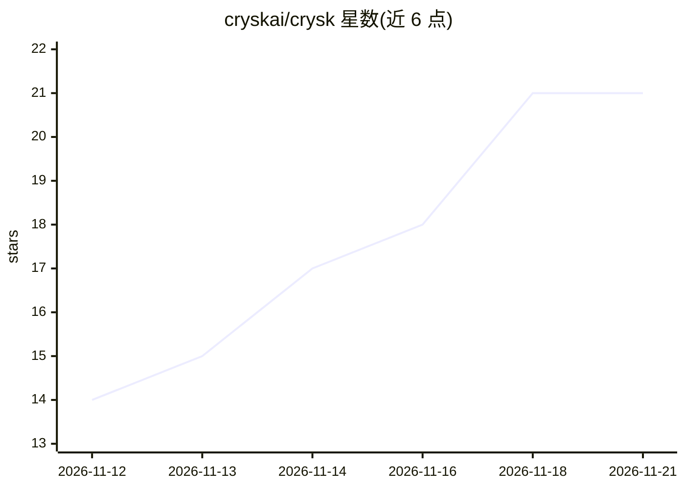

# cryskai/crysk

⭐ 21 · TypeScript · Apache-2.0 · 推送 2026-11-20 · [GitHub](https://github.com/cryskai/crysk) · [官网](https://crysk.dev) · 个人维护

**多智能体 PR 审查引擎：并行猎手找缺陷并分级阻断**

面向开发者的多智能体 PR 审查引擎，以 Claude Code CLI 与 OpenCode 为引擎：多个专长 hunter agent 并行扫描仓库检出与 diff，机械去重合并草案，对抗性 refuter 质疑每个严重发现，最终由确定性代码（非模型）分配 blocking/advisory 分级。自称高精度窄覆盖（实测 13% 误报），聚焦值契约、韧性、本地逻辑与信任边界缺陷，不查风格。本地定位为助手而非合并门禁；CI 中默认作为 commit status 门禁。提供 npm、独立二进制与 GitHub Actions 工作流三种用法，另有可装入任意 agent 的公开 skills。

## 筛选速览

| 维度 | 判定 | 备注 |
|---|---|---|
| AI 角色 | `ai-ecosystem` | LLM/agent 周边工具 |
| 许可风险 | `permissive` | Apache-2.0 |
| 部署形态 | `library` | 以包/库形式分发 |
| 模型依赖 | locked-api |  |
| 硬件要求 | — | 无带数字的原话,不猜 |
| 安装摩擦 | `low` | 无编译、无系统依赖或容器化 |
| 成熟度 | — | 结构信号不足 |

## 能力要点

- 并行专长 hunter + 对抗性 refuter + 确定性分级的多 agent 审查流水线
- 以 Claude Code CLI 子进程为引擎，继承其认证，支持订阅或 API key 计费
- 本地为助手不阻断合并；CI 中 commit status 默认为门禁
- CI-only 路径无需本机安装 Bun/Claude CLI，由 GitHub runner 自带运行时

## 适用场景

- 在 PR 流程中自动审查生命周期、状态机与信任边界类缺陷
- 开发者本地终端审查分支或 PR，得到带出处的分级报告
- 配合 Claude/OpenCode agent 用 skills 自动开 PR、跟进并修复审查发现

## 场景标签

`代码审查` `多智能体` · 领域:Agent 开发

## 证据(README 行号)

> L5: A multi-agent PR-review engine. Specialty hunter agents fan out in parallel over a repo checkout and
> L87: Crysk does not call any model API of its own. It **spawns the Claude Code CLI as a subprocess** and

## 星数曲线

2026-11-12 14 → 2026-11-21 21（+7）

---
*卡片 v1 · prompt 1.4 · 生成 2026-11-18 · 置信度 high · 依据 README sha `e67f69930b73` · [字段定义](../../DATASET.md)*
