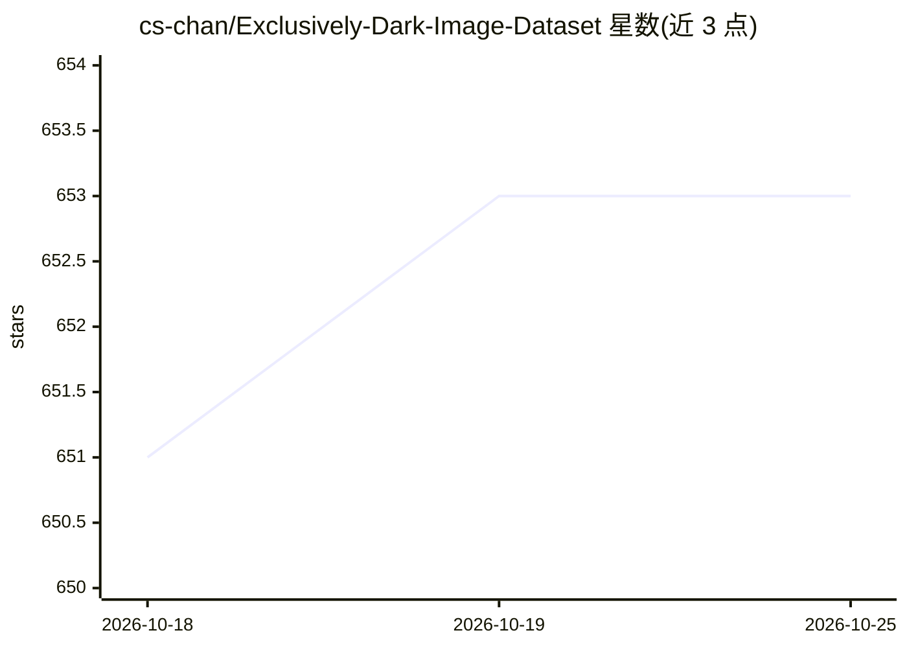

# cs-chan/Exclusively-Dark-Image-Dataset

⭐ 653 · MATLAB · BSD-3-Clause · 推送 2026-09-30 · [GitHub](https://github.com/cs-chan/Exclusively-Dark-Image-Dataset) · 组织维护

**低光照图像数据集：7,363 张暗光图像带目标框标注**

CVIU2019 论文配套的 Exclusively Dark (ExDark) 数据集，收录 7,363 张从极低光到暮光环境（10 种光照条件）的图像，含 12 个物体类别（类似 PASCAL VOC），提供图像级类别与物体级边界框双重标注，供低光环境下的目标检测与图像增强研究使用。另附作者的低光照图像增强源码（SPIC 文件夹）。标注与元数据限非商业学术研究使用，商业使用需书面许可。

## 筛选速览

| 维度 | 判定 | 备注 |
|---|---|---|
| AI 角色 | `ai-knowledge` | 知识聚合/清单类 |
| 许可风险 | `permissive` | BSD-3-Clause |
| 部署形态 | `None` |  |
| 模型依赖 | — | README 未给出锁定关系 |
| 硬件要求 | — | 无带数字的原话,不猜 |
| 安装摩擦 | `low` | 无编译、无系统依赖或容器化 |
| 成熟度 | — | 结构信号不足 |

## 能力要点

- 7,363 张低光照图像，覆盖 10 种光照条件
- 12 个物体类别的图像级与物体级边界框标注
- 附带低光照图像增强源码（SPIC 文件夹）
- 不同组成部分适用不同许可条款（代码/标注/第三方图像）

## 适用场景

- 低光照目标检测模型的训练与评测
- 低光照图像增强（图像翻译/域适应）研究
- 暗光条件下计算机视觉算法基准测试

## 场景标签

 · 领域:计算机视觉/数据集

## 证据(README 行号)

> L16: In order to facilitate a new object detection and image enhancement research particularly in the low-light environm
> L21: The source code for our work on low-light image enhancement is now available. Please refer to the SPIC folder.

## 星数曲线

2026-10-18 651 → 2026-10-25 653（+2）

---
*卡片 v1 · prompt 1.4 · 生成 2026-10-21 · 置信度 high · 依据 README sha `2ee396a28d7c` · [字段定义](../../DATASET.md)*
