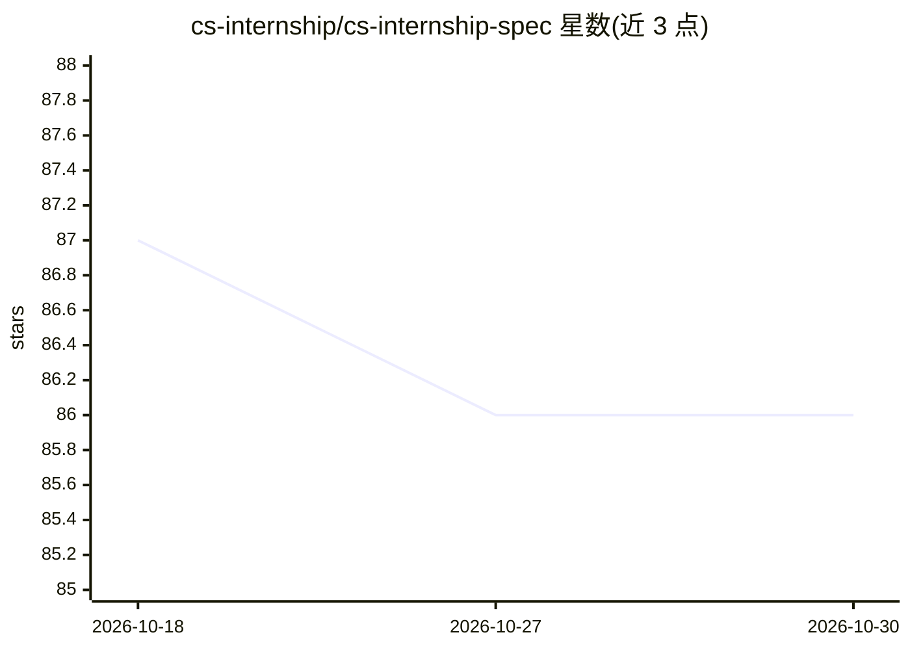

# cs-internship/cs-internship-spec

⭐ 86 · 推送 2026-10-26 · [GitHub](https://github.com/cs-internship/cs-internship-spec) · 组织维护

**软件工程实习项目的章程与课程规范文档**

Crystalline Society 社区维护的 CS Internship 项目规范仓库：定义项目宗旨、愿景使命、核心原则、四条技术路线（C#、Web/JavaScript、机器学习/Python、全栈 AI 工程师/.NET）、两个阶段（约 9 个月自学 + 6 个月实习）与平行成长路径（技术、业务、服务）。文档还规定导师团队四级晋升结构与参与方式，并声明毕业生达到初级软件工程师水平。仓库本身为文档规范，不提供可安装运行的软件。双语言（英语/波斯语）项目介绍。贡献方式限于文档改进、资源分享与工具提交。

## 筛选速览

| 维度 | 判定 | 备注 |
|---|---|---|
| AI 角色 | `ai-knowledge` | 知识聚合/清单类 |
| 许可风险 | `none` | — |
| 部署形态 | `None` |  |
| 模型依赖 | — | README 未给出锁定关系 |
| 硬件要求 | — | 无带数字的原话,不猜 |
| 安装摩擦 | `low` | 无编译、无系统依赖或容器化 |
| 成熟度 | — | 结构信号不足 |

## 能力要点

- 定义 4 条技术路线与 2 阶段（约 15 个月）培养结构
- 规定导师团队 4 级晋升体系与治理方式
- 以服务换服务、不涉及金钱交换的社区运行原则

## 适用场景

- 了解 CS Internship 项目的结构、原则并申请加入
- 作为社区成员参与规则改进与课程资源贡献
- 参考其课程与导师体系设计类似的培训项目

## 场景标签

 · 领域:教育/开源社区

## 证据(README 行号)

> L29: ### Tracks
> L32: - **Machine Learning (Python)**

## 星数曲线

2026-10-18 87 → 2026-10-30 86（-1）

---
*卡片 v1 · prompt 1.4 · 生成 2026-10-23 · 置信度 low · 依据 README sha `252b6bfa5bd0` · [字段定义](../../DATASET.md)*
